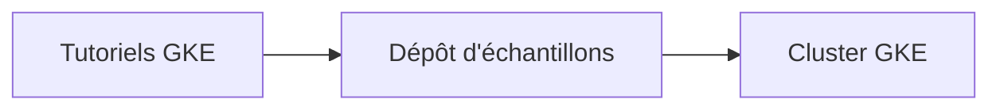

# GoogleCloudPlatform/kubernetes-engine-samples

> Exemples d'applications utilisés dans les tutoriels officiels de Google Kubernetes Engine.

## Le problème
Suivre les tutoriels GKE demande des applications d'exemple prêtes, versionnées et cohérentes avec la documentation.

## Ce que ça fait vraiment
Le dépôt regroupe les échantillons référencés par les guides et le démarrage rapide de GKE. Le README ne détaille pas leur contenu : il renvoie à la documentation Google et à une démo interactive.

## Comment c'est branché
Schéma simplifié d'après la fiche, sans diagramme fourni.

## Essayer
Aucune commande documentée dans le README : il renvoie aux guides et au démarrage rapide GKE.

## Coût et pièges
Un compte Google Cloud est nécessaire pour déployer sur GKE, avec facturation des ressources. Le dépôt lui-même est sous Apache-2.0.

## Ce que ce n'est pas
Pas une application complète ni un outil à installer : ce sont des exemples liés à des tutoriels.

## Alternatives
Aucune alternative nommée dans le README.

## Pour toi
À surveiller : utile comme point de départ si tu déploies des charges d'IA sur GKE, mais le README seul ne dit pas quels échantillons existent.

