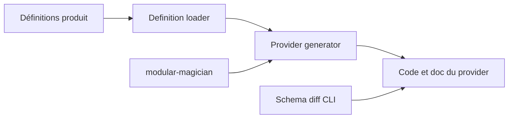

# GoogleCloudPlatform/magic-modules

> Code generator and CI that produces the `google` and `google-beta` Terraform providers.

## The problem
Maintaining two Terraform providers for Google Cloud by hand is costly and prone to drift.

## What it actually does
A single codebase for developing both provider versions. According to the schema: MMv1 loads product/resource definitions, validates them and generates the code and docs; an OpenAPI converter is experimental. Side tools: schema diff, template checking, changelog, issue labelling, TeamCity configuration. The `modular-magician` bot handles generation and tests.

## How it is wired

## Trying it
No command in this README; it points to the contribution documentation.

## Cost and gotchas
Very short README (insufficient material). The license is present but not identified by GitHub: to be checked. 482 open issues.

## What it is not
Not a tool for using the provider: it serves Google Cloud contributors to generate it.

## Alternatives
The README cites no alternative.

## For you
Ignore: internal provider-generation tooling, useful only if you contribute to the Google provider's code.
