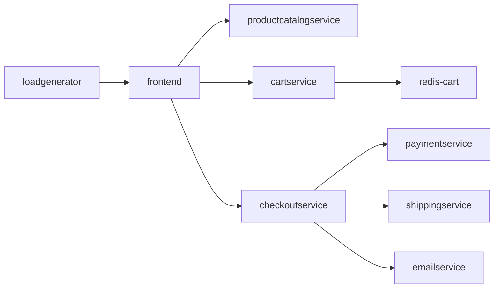

# GoogleCloudPlatform/microservices-demo

> A fake online shop made of 11 microservices, built to demonstrate Kubernetes deployments.

## The problem
Testing a service mesh, a tracing chain or a network policy requires a realistic application.
Building that application yourself takes more time than the experiment you wanted to run.

## What it actually does
Eleven services written in Go, C#, Node.js, Python and Java, talking to each other over gRPC.
A Python/Locust `loadgenerator` continuously sends traffic imitating purchase journeys.
Ready-to-apply Kubernetes manifests are in `./release/kubernetes-manifests.yaml`.
The Protocol Buffers definitions are in `./protos`; Kustomize variants cover Istio, Spanner, Memorystore.

## How it is wired


## Trying it
```bash
git clone --depth 1 --branch v0 https://github.com/GoogleCloudPlatform/microservices-demo.git
cd microservices-demo/
export PROJECT_ID=<PROJECT_ID>
export REGION=us-central1
gcloud services enable container.googleapis.com --project=${PROJECT_ID}
gcloud container clusters create-auto online-boutique --project=${PROJECT_ID} --region=${REGION}
kubectl apply -f ./release/kubernetes-manifests.yaml
kubectl get pods
```

## Cost and gotchas
The quickstart creates a GKE Autopilot cluster that is billed as long as it runs: the README ends with the
deletion command, it is not decorative. You need a Google Cloud project, `gcloud`, `git` and `kubectl`.

## What it is not
Not a shop: payment, shipping and email are explicitly simulated.
Not limited to GKE — the Development guide covers Minikube and Kind — but the documented path is Google Cloud.
Not an application base to take over: it is a demonstration, not a business codebase.

## Alternatives
None named in the README.

## For you
A credible test bench for trying tracing, service mesh or autoscaling before touching your production.
