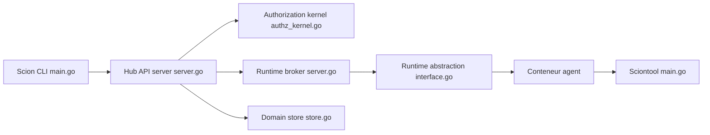

# GoogleCloudPlatform/scion

> A platform for orchestrating teams of AI agents in containers, for teams that run several agents.

## The problem
Getting several coding agents to collaborate means manually managing their environments, identities, communications and tracking.

## What it actually does
A Go CLI (`scion`) launches each agent (Claude Code, Antigravity, Codex, OpenCode...) as an independent process in a container, with its own credentials, and a shared space or a Git worktree. A Hub (local machine, VM, Cloud Run or HA with Postgres) manages state, identity and distribution to Runtime Brokers. Messages between agents, web interface, chat plugins (Telegram, Discord, Slack...).

## How it is wired


## Trying it
```bash
brew tap homebrew-scion/scion
brew install homebrew-scion/scion/scion
scion server start
cd my-project
scion init
scion start my-agent "Your task here"
```

## Cost and gotchas
Free (Apache-2.0); you need a container runtime (Docker, Podman, Apple Container or Kubernetes) and the credentials for each harness. The hosted Hub requires infrastructure (VM, Cloud Run or Postgres).

## What it is not
Not an official Google product (the README says so, outside the vulnerability reward program). Pre-1.0 project: API and configuration change between versions. It provides neither a model nor an agent of its own.

## Alternatives
No alternative named in the README.

## For you
Worth watching: interesting for experimenting with agent teams, but young and still shifting; reserve it for a test bench.
