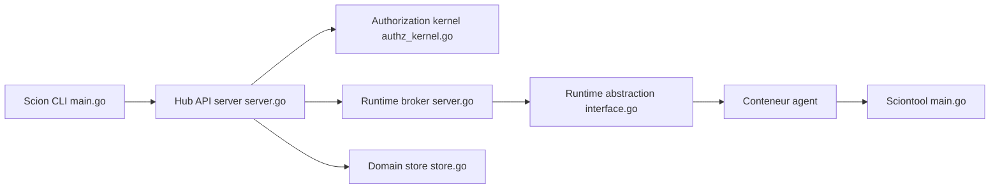

# GoogleCloudPlatform/scion

> Plateforme d'orchestration d'équipes d'agents IA en conteneurs, pour équipes qui font tourner plusieurs agents.

## Le problème
Faire collaborer plusieurs agents de code demande de gérer à la main leurs environnements, identités, communications et suivi.

## Ce que ça fait vraiment
Une CLI Go (`scion`) lance chaque agent (Claude Code, Antigravity, Codex, OpenCode…) comme processus indépendant dans un conteneur, avec ses identifiants, et un espace partagé ou un worktree Git. Un Hub (poste local, VM, Cloud Run ou HA avec Postgres) gère l'état, l'identité et la distribution vers des Runtime Brokers. Messages entre agents, interface web, plugins de chat (Telegram, Discord, Slack…).

## Comment c'est branché


## Essayer
```bash
brew tap homebrew-scion/scion
brew install homebrew-scion/scion/scion
scion server start
cd my-project
scion init
scion start my-agent "Your task here"
```

## Coût et pièges
Gratuit (Apache-2.0) ; il faut un runtime de conteneurs (Docker, Podman, Apple Container ou Kubernetes) et les identifiants de chaque harness. Le Hub hébergé demande une infrastructure (VM, Cloud Run ou Postgres).

## Ce que ce n'est pas
Pas un produit Google officiel (le README le dit, hors programme de primes de vulnérabilité). Projet pré-1.0 : API et configuration changent entre versions. Il ne fournit ni modèle ni agent propre.

## Alternatives
Aucune alternative nommée dans le README.

## Pour toi
À surveiller : intéressant pour expérimenter des équipes d'agents, mais jeune et encore mouvant ; réserve-le à un banc d'essai.

