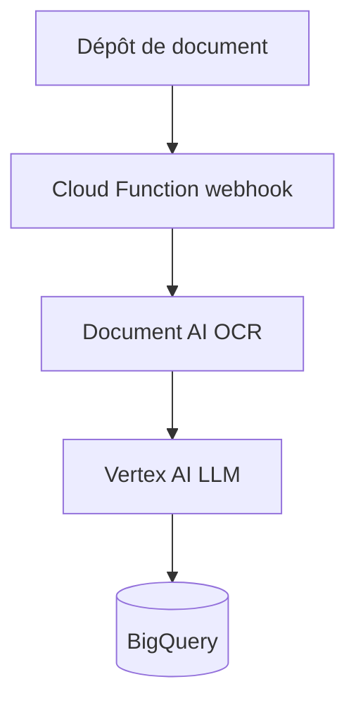

# GoogleCloudPlatform/terraform-genai-doc-summarization

> Google Cloud Terraform plan that summarizes documents with Document AI and Vertex AI, for AI teams.

## The problem
Summarizing a large corpus of scanned documents requires chaining text recognition, a language model and storage.

## What it actually does
A document drop triggers a webhook Cloud Function. Document AI extracts the text by OCR, a Vertex AI language model summarizes it, and the summaries are stored in BigQuery. The plan creates the buckets, the Document AI processor and the dataset.

## How it is wired
Simplified diagram based on the sheet, no diagram provided.

## Trying it
No command documented in the README; it lists the variables (`project_id` required, `region`, `documentai_location`) and the outputs.

## Cost and gotchas
An active Google Cloud billing account with billing permissions. Document AI, Vertex AI and BigQuery are billed. The README claims 1 minute of setup and 5 minutes of deployment.

## What it is not
Not a product: it is a solution demonstration. It only works with Google Cloud. The README prerequisites (Terraform 0.13) look outdated.

## Alternatives
No alternative named in the README.

## For you
Worth watching: a good summarization architecture model on Google Cloud for an AI engineer, to read before deploying it, given the bill.
