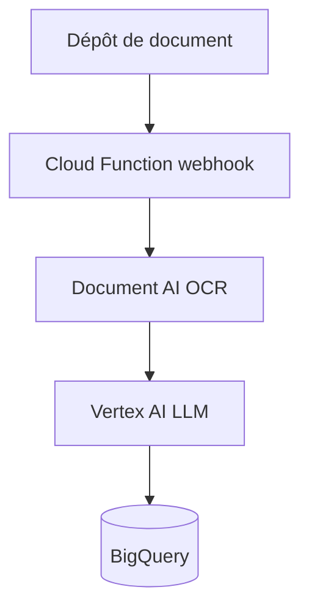

# GoogleCloudPlatform/terraform-genai-doc-summarization

> Plan Terraform Google Cloud qui résume des documents avec Document AI et Vertex AI, pour équipes IA.

## Le problème
Résumer un grand corpus de documents scannés demande d'enchaîner reconnaissance de texte, modèle de langage et stockage.

## Ce que ça fait vraiment
Un dépôt de documents déclenche une Cloud Function webhook. Document AI en extrait le texte par OCR, un modèle de langage Vertex AI le résume, et les résumés sont stockés dans BigQuery. Le plan crée les buckets, le processeur Document AI et le jeu de données.

## Comment c'est branché
Schéma simplifié d'après la fiche, sans diagramme fourni.

## Essayer
Aucune commande documentée dans le README ; il liste les variables (`project_id` obligatoire, `region`, `documentai_location`) et les sorties.

## Coût et pièges
Compte de facturation Google Cloud actif avec droits de facturation. Document AI, Vertex AI et BigQuery sont facturés. Le README donne 1 minute de configuration et 5 minutes de déploiement.

## Ce que ce n'est pas
Pas un produit : c'est une démonstration de solution. Il ne fonctionne qu'avec Google Cloud. Les prérequis (Terraform 0.13) du README paraissent anciens.

## Alternatives
Aucune alternative nommée dans le README.

## Pour toi
À surveiller : bon modèle d'architecture de résumé sur Google Cloud pour un ingénieur IA, à lire avant de le déployer, vu la facture.

