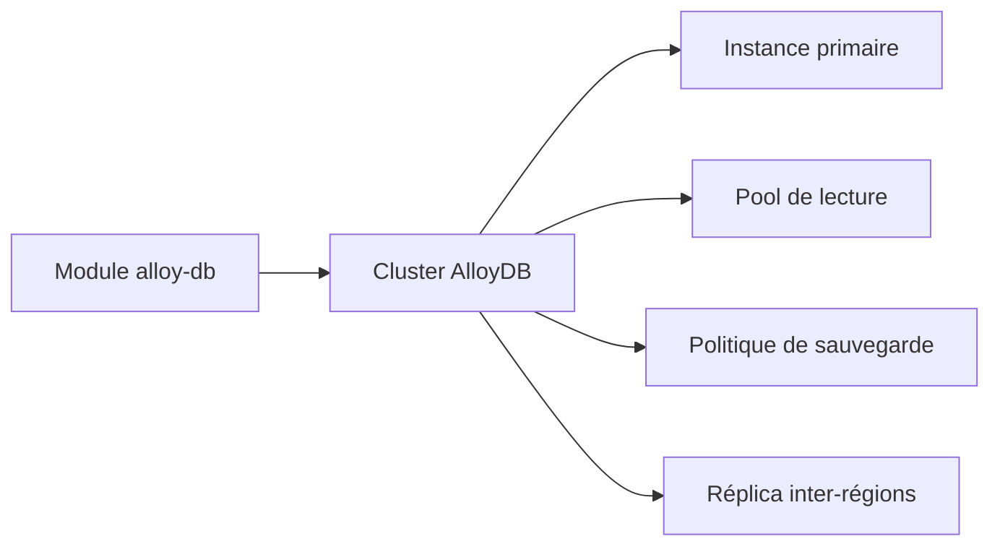

# GoogleCloudPlatform/terraform-google-alloy-db

> Terraform module that creates an AlloyDB cluster on Google Cloud, with a primary instance and read replicas.

## The problem
Deploying AlloyDB with backups, replicas and private connectivity by hand requires many linked resources.

## What it actually does
The module creates an AlloyDB cluster, with or without an automated backup policy, a primary instance and read pools. It also handles a cross-region replica, Private Service Connect, encryption with KMS keys and restoration from a backup.

## How it is wired
Simplified diagram based on the fiche, no diagram provided.



## Trying it
```bash
module "alloy-db" {
  source     = "GoogleCloudPlatform/alloy-db/google"
  version    = "~> 8.0"
  project_id = <"PROJECT_ID">
  cluster_id = "alloydb-cluster"
  location   = "us-central1"
}
```

## Cost and gotchas
A GCP project with the `alloydb.googleapis.com` API and a service account with the `roles/alloydb.admin` role. AlloyDB is billed by Google. Terraform 1.3 or later.

## What it is not
Not a database: it only provisions it. The README announces version 9.X but the example pins `~> 8.0`.

## Alternatives
No alternative named in the README.

## For you
Worth watching: interesting if you host vector or transactional data on AlloyDB, otherwise irrelevant.
