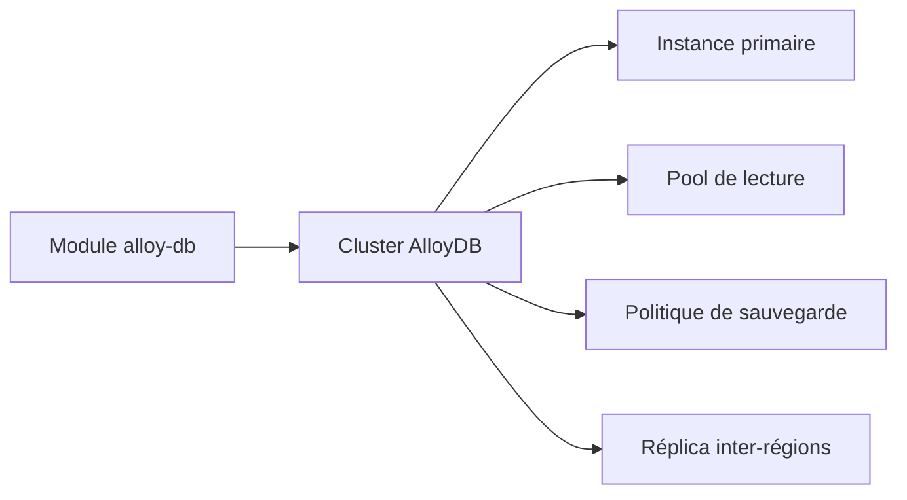

# GoogleCloudPlatform/terraform-google-alloy-db

> Module Terraform qui crée un cluster AlloyDB sur Google Cloud, avec instance primaire et réplicas de lecture.

## Le problème
Déployer AlloyDB avec sauvegardes, réplicas et connectivité privée à la main demande de nombreuses ressources liées.

## Ce que ça fait vraiment
Le module crée un cluster AlloyDB, avec ou sans politique de sauvegarde automatisée, une instance primaire et des pools de lecture. Il gère aussi un réplica inter-régions, Private Service Connect, le chiffrement par clés KMS et la restauration depuis une sauvegarde.

## Comment c'est branché
Schéma simplifié d'après la fiche, sans diagramme fourni.



## Essayer
```bash
module "alloy-db" {
  source     = "GoogleCloudPlatform/alloy-db/google"
  version    = "~> 8.0"
  project_id = <"PROJECT_ID">
  cluster_id = "alloydb-cluster"
  location   = "us-central1"
}
```

## Coût et pièges
Projet GCP avec l'API `alloydb.googleapis.com` et un compte de service au rôle `roles/alloydb.admin`. AlloyDB est facturé par Google. Terraform 1.3 ou plus.

## Ce que ce n'est pas
Pas une base de données : il ne fait que la provisionner. Le README annonce la version 9.X mais l'exemple épingle `~> 8.0`.

## Alternatives
Aucune alternative nommée dans le README.

## Pour toi
À surveiller : intéressant si tu héberges des données vectorielles ou transactionnelles sur AlloyDB, sinon sans objet.

