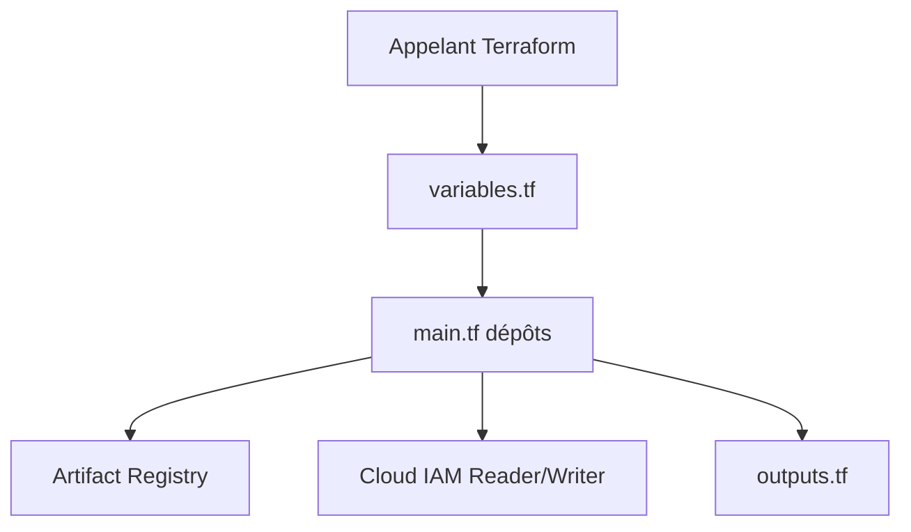

# GoogleCloudPlatform/terraform-google-artifact-registry

> Terraform module to create Artifact Registry repositories on Google Cloud, for platform teams.

## The problem
Creating package repositories (docker, pypi, npm…) by hand, with their permissions and cleanup rules, is repetitive and hard to audit.

## What it actually does
Creates Artifact Registry repositories in docker, apt, yum, go, pypi, npm and maven formats, in standard, remote or virtual mode. Handles cleanup policies, per-format config, KMS key, VPC-SC policy and Reader/Writer roles. Returns `artifact_id`, `artifact_name`, `create_time` and `update_time`.

## How it is wired


## Trying it
```bash
# Pas de commande dans le README : utiliser le bloc HCL
# module "artifact_registry" { source = "GoogleCloudPlatform/artifact-registry/google"
#   version = "~> 0.8"  project_id = "..."  location = "..."  format = "..."  repository_id = "..." }
```

## Cost and gotchas
A GCP project with billing enabled, and the Artifact Registry, Secret Manager and Context Manager APIs enabled. A service account with admin roles is required; Terraform v0.13+ and GCP provider 5.26.0+.

## What it is not
Not a standalone registry: it configures Google's managed service. The README does not state the test status.

## Alternatives
None named in the README.

## For you
Watch: useful if you publish model images or packages on GCP with Terraform, otherwise irrelevant.
