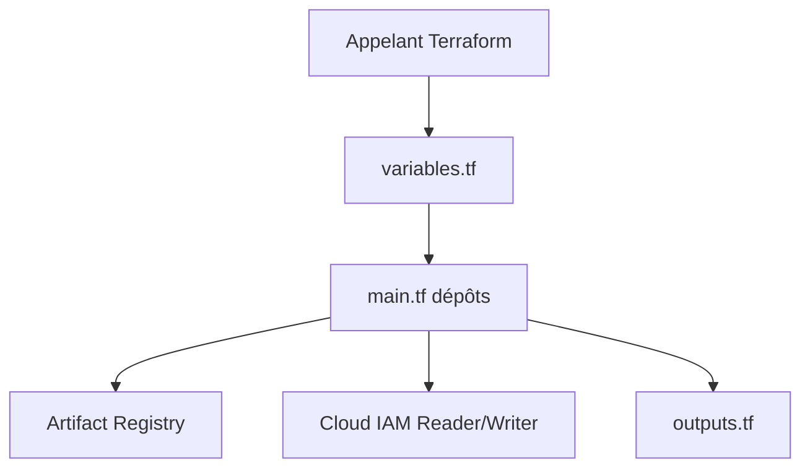

# GoogleCloudPlatform/terraform-google-artifact-registry

> Module Terraform pour créer des dépôts Artifact Registry sur Google Cloud, pour équipes plateforme.

## Le problème
Créer à la main des dépôts de paquets (docker, pypi, npm…) avec leurs droits et règles de nettoyage est répétitif et peu auditable.

## Ce que ça fait vraiment
Crée des dépôts Artifact Registry aux formats docker, apt, yum, go, pypi, npm et maven, en mode standard, distant ou virtuel. Gère politiques de nettoyage, config par format, clé KMS, politique VPC-SC et rôles Reader/Writer. Retourne `artifact_id`, `artifact_name`, `create_time` et `update_time`.

## Comment c'est branché


## Essayer
```bash
# Pas de commande dans le README : utiliser le bloc HCL
# module "artifact_registry" { source = "GoogleCloudPlatform/artifact-registry/google"
#   version = "~> 0.8"  project_id = "..."  location = "..."  format = "..."  repository_id = "..." }
```

## Coût et pièges
Projet GCP avec facturation active, APIs Artifact Registry, Secret Manager et Context Manager activées. Un compte de service avec rôles admin est requis ; Terraform v0.13+ et provider GCP 5.26.0+.

## Ce que ce n'est pas
Pas un registre autonome : il configure le service géré de Google. Le README ne précise pas l'état des tests.

## Alternatives
Aucune nommée dans le README.

## Pour toi
Surveiller : utile si tu publies des images ou paquets de modèles sur GCP avec Terraform, sinon sans objet.

