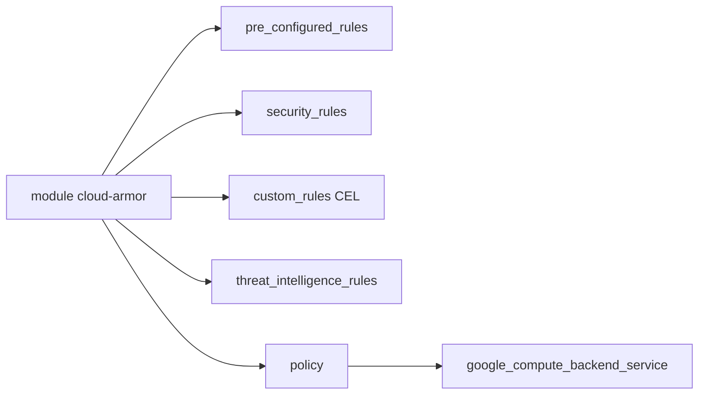

# GoogleCloudPlatform/terraform-google-cloud-armor

> Terraform module for a Cloud Armor policy (WAF, IP, CEL rules) in front of Google Cloud load balancers.

## The problem
Writing WAF, rate-limiting and IP filtering rules for Cloud Armor by hand is verbose and hard to review.

## What it actually does
Creates a global security policy with five rule types: preconfigured (OWASP), IP, custom CEL, threat intelligence, and auto-deployment of the rules from adaptive protection. Handles rate limiting, banning, WAF exclusions and reCAPTCHA. The policy attaches to a backend service.

## How it is wired


## Trying it
```hcl
module "security_policy" {
  source  = "GoogleCloudPlatform/cloud-armor/google"
  version = "~> 10.0"
  project_id          = var.project_id
  name                = "my-test-security-policy"
  default_rule_action = "allow"
  type                = "CLOUD_ARMOR"
}
```

## Cost and gotchas
A Google Cloud project is required. The threat intelligence rules require a Managed Protection Plus subscription. Major version upgrades (7 to 10) have migration guides.

## What it is not
It is not an offensive tool: it protects services. It does not cover regional or passthrough load balancers, which have other submodules.

## Alternatives
No alternative named in the README.

## For you
Worth watching: useful for securing a model API served on Google Cloud, useless outside that platform.
