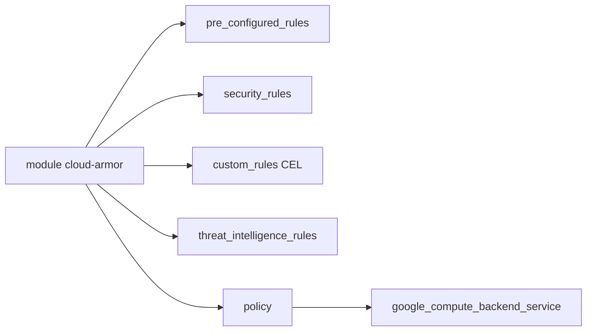

# GoogleCloudPlatform/terraform-google-cloud-armor

> Module Terraform pour une politique Cloud Armor (WAF, IP, règles CEL) devant des répartiteurs de charge Google Cloud.

## Le problème
Écrire à la main des règles WAF, de limitation de débit et de filtrage IP pour Cloud Armor est verbeux et difficile à relire.

## Ce que ça fait vraiment
Crée une politique de sécurité globale avec cinq types de règles : préconfigurées (OWASP), IP, personnalisées en CEL, renseignement sur les menaces et déploiement automatique des règles de la protection adaptative. Gère la limitation de débit, le bannissement, les exclusions WAF et reCAPTCHA. La politique s'attache à un service backend.

## Comment c'est branché


## Essayer
```hcl
module "security_policy" {
  source  = "GoogleCloudPlatform/cloud-armor/google"
  version = "~> 10.0"
  project_id          = var.project_id
  name                = "my-test-security-policy"
  default_rule_action = "allow"
  type                = "CLOUD_ARMOR"
}
```

## Coût et pièges
Projet Google Cloud requis. Les règles de renseignement sur les menaces demandent l'abonnement Managed Protection Plus. Les montées de version majeure (7 à 10) ont des guides de migration.

## Ce que ce n'est pas
Ce n'est pas un outil offensif : il protège des services. Il ne couvre pas les répartiteurs régionaux ni passthrough, qui ont d'autres sous-modules.

## Alternatives
Aucune alternative nommée dans le README.

## Pour toi
À surveiller : utile pour sécuriser l'API d'un modèle servie sur Google Cloud, inutile hors de cette plateforme.

