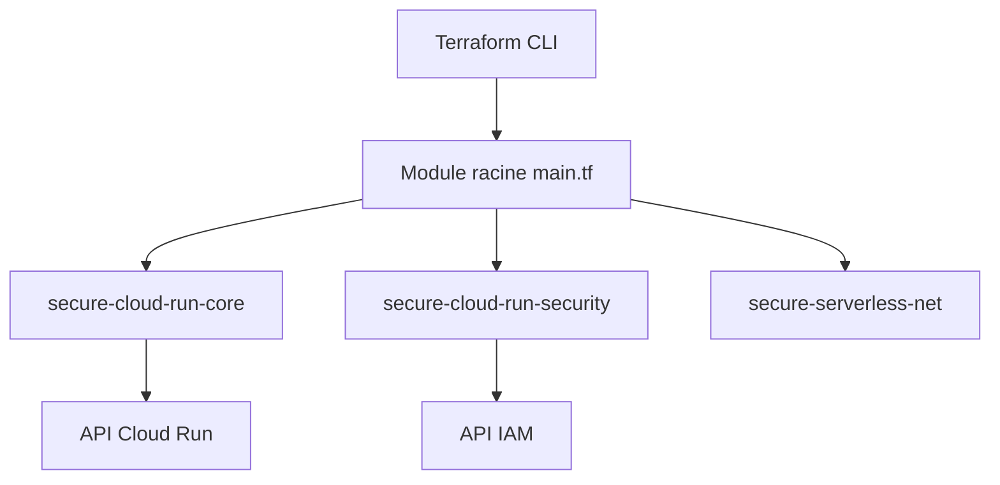

# GoogleCloudPlatform/terraform-google-cloud-run

> Terraform module that deploys a Cloud Run service on GCP with a domain and invocation permissions.

## The problem
Deploying a container on Cloud Run with a custom domain and IAM by hand is not reproducible.

## What it actually does
Creates a Cloud Run service (name, image, resources, probes, secrets), a domain mapping and the invoker role for the listed members. Submodules handle security, networking, job execution and a project factory.

## How it is wired


## Trying it
```bash
# Bloc HCL du README
# module "cloud_run" { source = "GoogleCloudPlatform/cloud-run/google" ... }
```
No shell command documented.

## Cost and gotchas
The module is free; Cloud Run is billed. Requires Terraform 1.3 or later, GCP provider below 6, the APIs enabled and the `roles/run.admin` role. The README comment mentions version 0.20 while the example asks for `~> 0.34`.

## What it is not
Not a deployment platform: no image build, no pipeline. Does not cover creating the GCP project for the root module (separate submodule).

## Alternatives
None named in the README.

## For you
Useful for exposing a model service or API on Cloud Run via Terraform; otherwise of no interest.
