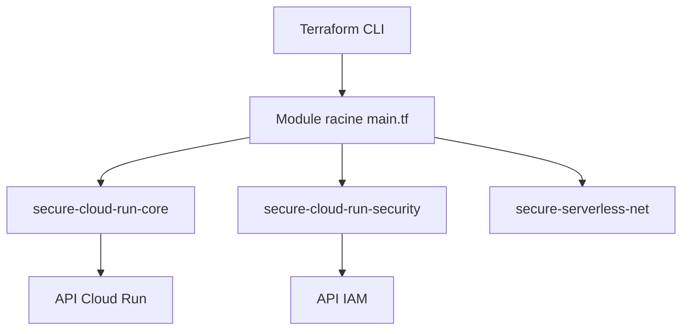

# GoogleCloudPlatform/terraform-google-cloud-run

> Module Terraform qui déploie un service Cloud Run sur GCP avec domaine et droits d'invocation.

## Le problème
Déployer un conteneur sur Cloud Run avec domaine personnalisé et IAM à la main n'est pas reproductible.

## Ce que ça fait vraiment
Crée un service Cloud Run (nom, image, ressources, sondes, secrets), un mappage de domaine et le rôle d'invocateur pour les membres listés. Des sous-modules traitent la sécurité, le réseau, l'exécution de jobs et une fabrique de projets.

## Comment c'est branché


## Essayer
```bash
# Bloc HCL du README
# module "cloud_run" { source = "GoogleCloudPlatform/cloud-run/google" ... }
```
Aucune commande shell documentée.

## Coût et pièges
Module gratuit ; Cloud Run est facturé. Il faut Terraform 1.3 ou plus, fournisseur GCP inférieur à 6, les API activées et le rôle `roles/run.admin`. Le commentaire du README parle de la version 0.20 alors que l'exemple demande `~> 0.34`.

## Ce que ce n'est pas
Pas une plateforme de déploiement : ni construction d'image, ni pipeline. Ne couvre pas la création du projet GCP pour la racine (sous-module séparé).

## Alternatives
Aucune nommée dans le README.

## Pour toi
Utile pour exposer un service ou une API de modèle sur Cloud Run via Terraform ; sinon sans intérêt.

