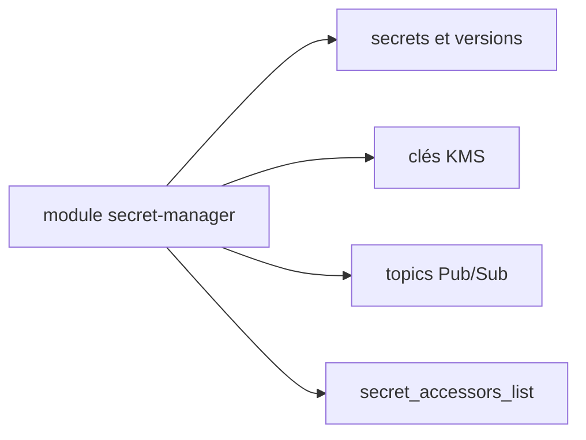

# GoogleCloudPlatform/terraform-google-secret-manager

> Terraform module for creating Google Secret Manager secrets with KMS encryption and rotation notifications.

## The problem
Declaring secrets, their replication, their access and their rotation in Google Cloud takes many resources and IAM permissions.

## What it actually does
Creates Secret Manager secrets, with automatic or user-managed replication, optional KMS keys, access lists and a TTL for destroying versions. If rotation is enabled and Pub/Sub topics are provided, notifications are sent. The README mentions a diagram of the deployed resources, which is absent from the text.

## How it is wired
Simplified diagram based on the sheet, no diagram provided.



## Trying it
```hcl
module "secret-manager" {
  source     = "GoogleCloudPlatform/secret-manager/google"
  version    = "~> 0.10"
  project_id = var.project_id
  secrets = [
    { name = "secret-1", secret_data = "secret information" },
  ]
}
```

## Cost and gotchas
A Google Cloud project with the Secret Manager API enabled and a service account with `roles/secretmanager.admin`. Modifying KMS or Pub/Sub IAM also requires `roles/resourcemanager.projectIamAdmin`. The README states Terraform v0.13, which is old.

## What it is not
It is not a vault: it drives Google's. Secret data passed to the module stays in the Terraform state.

## Alternatives
- lgallard/terraform-aws-secrets-manager: the AWS equivalent, if cited in the batch.

## For you
Worth watching: an official building block useful for your secrets on Google Cloud with Terraform, to be protected on the state side.
