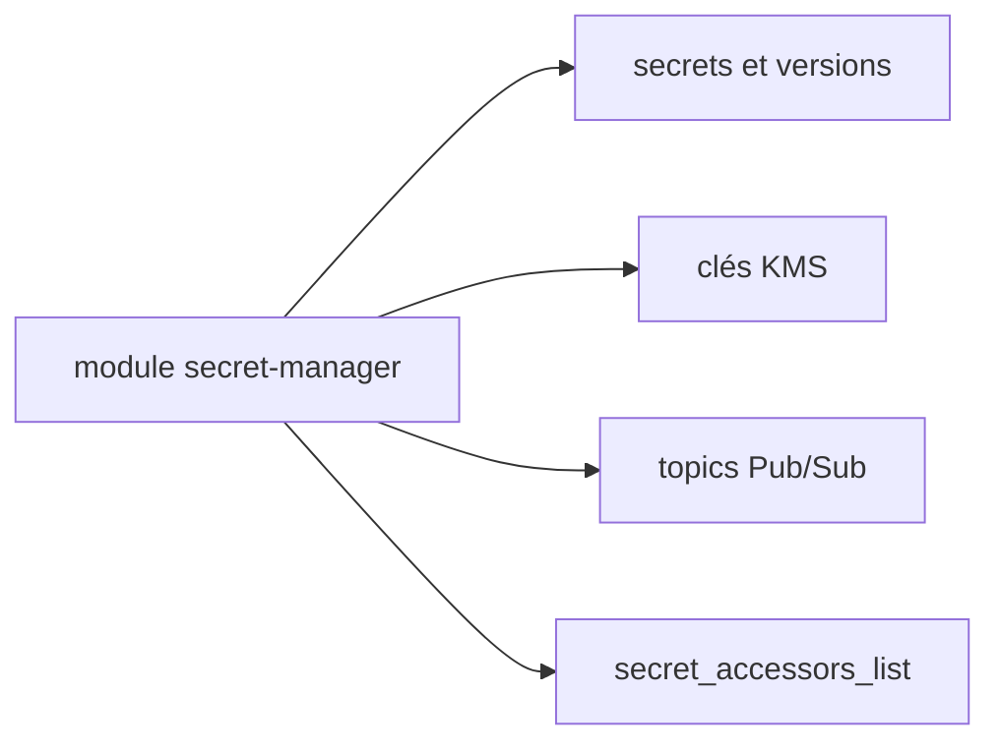

# GoogleCloudPlatform/terraform-google-secret-manager

> Module Terraform pour créer des secrets Google Secret Manager avec chiffrement KMS et notifications de rotation.

## Le problème
Déclarer des secrets, leur réplication, leurs accès et leur rotation dans Google Cloud demande beaucoup de ressources et d'autorisations IAM.

## Ce que ça fait vraiment
Crée des secrets Secret Manager, avec réplication automatique ou gérée par l'utilisateur, clés KMS optionnelles, listes d'accès et TTL de destruction des versions. Si la rotation est activée et des topics Pub/Sub fournis, des notifications sont envoyées. Le README mentionne un diagramme des ressources déployées, absent du texte.

## Comment c'est branché
Schéma simplifié d'après la fiche, sans diagramme fourni.



## Essayer
```hcl
module "secret-manager" {
  source     = "GoogleCloudPlatform/secret-manager/google"
  version    = "~> 0.10"
  project_id = var.project_id
  secrets = [
    { name = "secret-1", secret_data = "secret information" },
  ]
}
```

## Coût et pièges
Projet Google Cloud avec l'API Secret Manager activée et un compte de service `roles/secretmanager.admin`. Modifier l'IAM de KMS ou Pub/Sub exige aussi `roles/resourcemanager.projectIamAdmin`. Le README indique Terraform v0.13, ancien.

## Ce que ce n'est pas
Ce n'est pas un coffre-fort : il pilote celui de Google. Les données secrètes passées au module restent dans l'état Terraform.

## Alternatives
- lgallard/terraform-aws-secrets-manager : équivalent côté AWS, s'il est cité dans le lot.

## Pour toi
À surveiller : brique officielle utile pour tes secrets sur Google Cloud avec Terraform, à protéger côté état.

