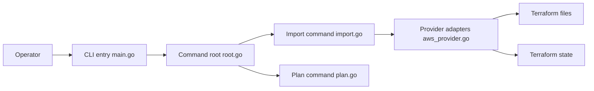

# GoogleCloudPlatform/terraformer

> CLI that generates Terraform files and tfstate from existing cloud infrastructure.

## The problem
Infrastructure created by hand cannot be brought under Terraform without rewriting all the resources.

## What it actually does
"Reverse Terraform": lists a provider's resources (GCP, AWS, Azure, Kubernetes, GitHub, Datadog…), fetches their attributes via the Terraform providers.
Writes `.tf`/`.json` and `tfstate`, links resources through `terraform_remote_state`, remote state possible on GCS.
Filters by ID, type, tags; `plan` command to review before import.

## How it is wired


## Trying it
```bash
brew install terraformer
terraformer import aws --resources=vpc,subnet --filter=vpc=myvpcid --regions=eu-west-1
terraformer plan google --resources=networks,firewall --projects=my-project --regions=europe-west1-d
```

## Cost and gotchas
Free; requires Terraform and the provider plugins, plus read permissions on the cloud.

## What it is not
Archived on March 16, 2026: no more security fixes. Not an official Google product.

## Alternatives
- terraforming: AWS only, fragile templates according to the README; prefer it only for historical reasons.

## For you
Ignore: archived and unmaintained, to be used only for a one-off import with full awareness.
