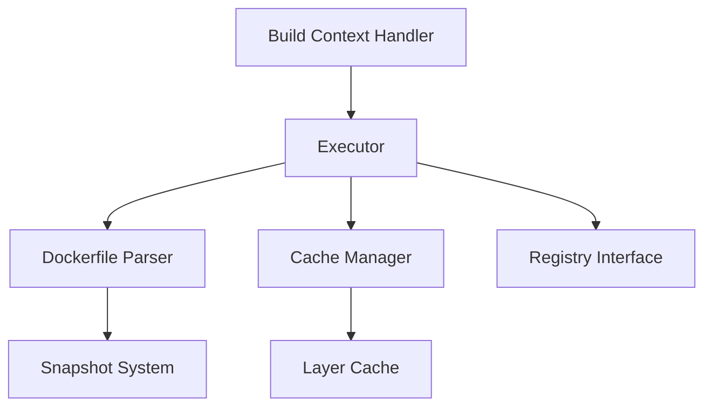

# GoogleContainerTools/kaniko

> Builds container images from a Dockerfile inside Kubernetes, without a Docker daemon. It is archived.

## The problem
Building images in a CI pod without access to the Docker daemon or a privileged container.

## What it actually does
The executor image extracts the base image's filesystem, runs each Dockerfile command, then takes a snapshot in user space.
The build context can come from GCS, S3, Azure Blob, Git, a tar or stdin.
It caches RUN and COPY layers in a registry, and the warmer caches base images.
It pushes to GCR, ECR, ACR, Docker Hub and JFrog.

## How it is wired


## Trying it
```shell
tar -C <path to build context> -zcvf context.tar.gz .
kubectl create secret generic kaniko-secret --from-file=<path to kaniko-secret.json>
./run_in_docker.sh <path to Dockerfile> <path to build context> <destination of final image>
docker run -it --entrypoint=/busybox/sh gcr.io/kaniko-project/executor:debug
```

## Cost and gotchas
It is free but archived since 2025-06: no more security fixes. It does not make untrusted builds safe.

## What it is not
It is no longer a maintained project. It does not build Windows containers or multi-architecture manifests.

## Alternatives
- BuildKit / img: rootless, but seccomp and AppArmor must be disabled.
- buildah: rootless, daemonless OCI builds.
- umoci, orca-build, FTL, Bazel rules_docker: lower-level or specialized approaches.

## For you
Ignore it: it is archived. To build your ML images in CI, go with BuildKit or buildah.
