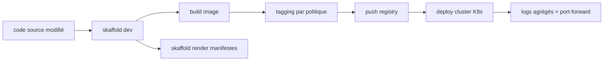

# GoogleContainerTools/skaffold

> Continuous development loop for Kubernetes applications, with no cluster-side component.

## The problem
Changing a line of code and seeing it run in a cluster means replaying build, push, tag and redeploy by hand at every iteration.

## What it actually does
Detects changes in the sources and automatically chains build, push and deploy, with policy-driven image tagging. Aggregates the logs of deployed resources and port-forwards to the local machine. `skaffold init` discovers the project's files and generates the configuration. Profiles, user config, environment variables and flags describe the differences between environments. `skaffold run` covers the whole flow, or you compose your own pipeline phase by phase; `skaffold render` outputs hydrated Kubernetes manifests usable for GitOps. Pluggable architecture to hook in any build or deploy tool, multi-component applications supported.

## How it is wired

## Trying it
No install command in the README: it points to the "Install Skaffold" page and to GitHub Releases.

## Cost and gotchas
Free. It needs a Kubernetes cluster, local or remote, and an image registry. No component is installed on the cluster side, so nothing to maintain there.

## What it is not
Not a CI server nor a production deployment tool by itself: it provides building blocks to construct one. No release management or rollback described. The README uses promotional vocabulary that is not repeated here.

## Alternatives
- Cloud Code (VS Code, JetBrains): the same thing as a managed extension, by Google.

## For you
Useful if you iterate on an ML service packaged as a container on Kubernetes; without a cluster, irrelevant.
