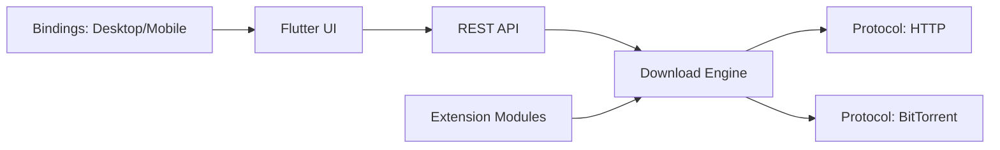

# GopeedLab/gopeed

> Go and Flutter download manager: HTTP, BitTorrent, magnet and ed2k, on desktop, mobile and web.

## The problem
Downloading large files or torrents with resume, task management and automation often takes several applications.

## What it actually does
A Go core handles the download engine, the HTTP and BitTorrent protocols, the REST API and JavaScript extensions. The Flutter interface talks to it over HTTP (Unix socket, or TCP on Windows); in 2.0 beta, via FFI. It offers a CLI, a web interface, webhooks, a browser extension and an MCP endpoint that lets an AI agent create and track downloads.

## How it is wired


## Trying it
```bash
go install github.com/GopeedLab/gopeed/cmd/gopeed@latest
git clone git@github.com:GopeedLab/gopeed.git
```

## Cost and gotchas
Free. Building from source: Go 1.25+, Flutter 3.41+ and a C toolchain. Version 2.0 is in beta, with possibly unstable features. GPL-3.0.

## What it is not
It is not a media client: it downloads. The MCP endpoint gives an agent the power to act on disk and network, to be restricted.

## Alternatives
- No alternative named in the README.

## For you
Watch: handy for fetching large datasets or models, and the MCP API is an example of a tool for agents.
