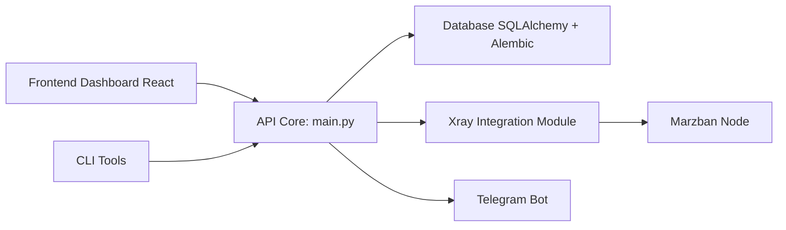

# Gozargah/Marzban

> Web panel for managing anti-censorship proxy accounts based on Xray-core.

## The problem
Managing hundreds of Xray proxy users (quotas, expirations, links) by hand in JSON files.

## What it actually does
A Python REST backend (FastAPI, SQLAlchemy, Alembic) and a React dashboard.
Vmess, VLESS, Trojan, Shadowsocks protocols; TLS and REALITY; multiple nodes.
Traffic and expiration limits, subscription links compatible with V2ray and Clash, QR codes.
Telegram bot, CLI, webhooks, backups sent to Telegram.

## How it is wired


## Trying it
```bash
sudo bash -c "$(curl -sL https://github.com/Gozargah/Marzban-scripts/raw/master/marzban.sh)" @ install
marzban cli admin create --sudo
```

## Cost and gotchas
Free; a domain and an SSL certificate are needed to access the dashboard. The install script is run as root via curl.

## What it is not
Not a turnkey VPN for a workstation: it is a server administration tool.

## Alternatives
No alternative is named in the README.

## For you
Ignore: it is proxy administration, with no connection to data or AI.
