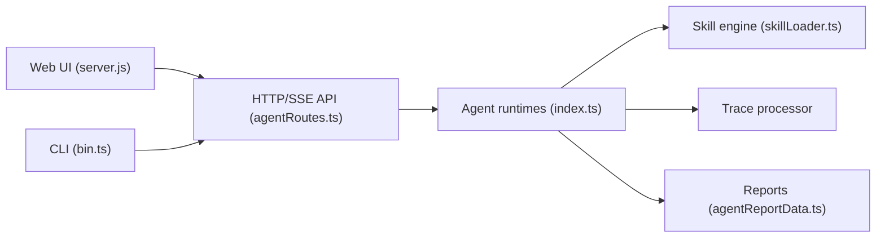

# Gracker/SmartPerfetto

> AI analysis layer on Android Perfetto traces: jank, startup, ANR, memory.

## The problem
Reading a Perfetto trace requires writing SQL and knowing Android internals.

## What it actually does
You load a trace, ask a question in natural language, and the tool runs deterministic YAML skills and SQL queries, then returns a conclusion with evidence verified by the server. Web interface, `smp` CLI, HTTP/SSE API. Optional local source-code analysis, with excerpts sent to the AI provider.

## How it is wired


## Trying it
```bash
docker compose -f docker-compose.hub.yml up -d
./start.sh
npm install -g @gracker/smartperfetto
smp doctor
smp run trace.pftrace "Analyze scrolling jank"
```

## Cost and gotchas
An AI provider must be configured (API key at your expense). Node.js 24 LTS for the source. License present but not identified by GitHub.

## What it is not
Not a general-purpose profiling tool; public APIs may change. Conclusions still need to be checked against the exposed evidence.

## Alternatives
Perfetto Skills (agent-based analysis) and TraceFix, Perfetto Tools from the same family.

## For you
Ignore, unless you analyze Android performance: a good example of AI backed by evidence, but a very narrow domain.
