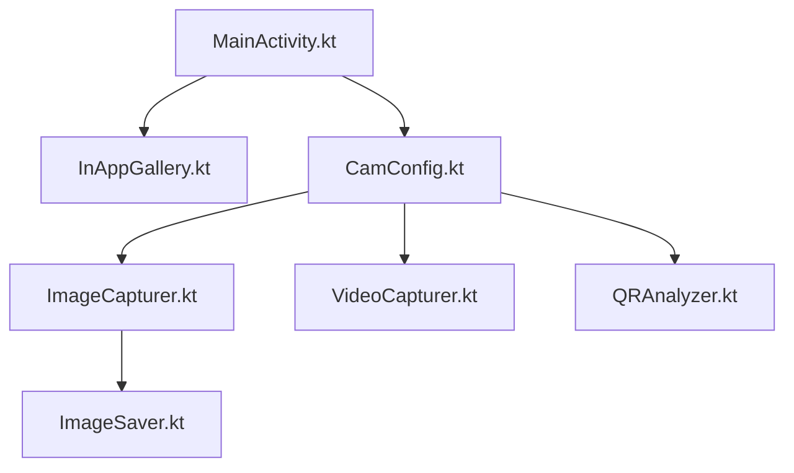

# GrapheneOS/Camera

> GrapheneOS camera app, built on CameraX, which replaces the AOSP one.

## The problem
The README does not say: it only describes the replacement of the AOSP camera.

## What it actually does
Based on the architecture: MainActivity configures the camera via CamConfig, which drives image and video capture on CameraX and saving through ImageSaver. An analyzer reads QR codes, a built-in gallery displays captures, and instrumented tests cover regressions.

## How it is wired

## Trying it
No command documented in the README.

## Cost and gotchas
Free. Designed for GrapheneOS: use elsewhere is not documented. 141 open issues.

## What it is not
Not a general photography or image-processing tool: a component of a specific Android system.

## Alternatives
No alternative named in the README.

## For you
Ignore: a mobile OS component unrelated to data, AI or MLOps work, and an almost empty README.
