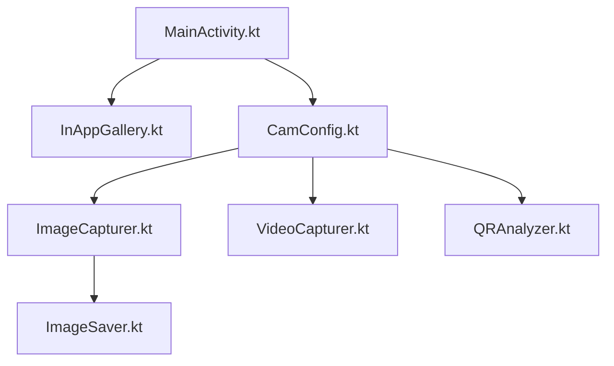

# GrapheneOS/Camera

> Application appareil photo de GrapheneOS, fondée sur CameraX, qui remplace celle d'AOSP.

## Le problème
Le README ne le dit pas : il décrit seulement le remplacement de l'appareil photo AOSP.

## Ce que ça fait vraiment
D'après l'architecture : MainActivity configure la caméra via CamConfig, qui pilote la capture d'images et de vidéos sur CameraX et l'enregistrement par ImageSaver. Un analyseur lit les QR codes, une galerie intégrée affiche les captures, et des tests instrumentés couvrent les régressions.

## Comment c'est branché

## Essayer
Aucune commande documentée dans le README.

## Coût et pièges
Gratuit. Conçue pour GrapheneOS : l'usage ailleurs n'est pas documenté. 141 issues ouvertes.

## Ce que ce n'est pas
Pas un outil général de photographie ni de traitement d'image : un composant d'un système Android précis.

## Alternatives
Aucune alternative nommée dans le README.

## Pour toi
Ignorer : un composant d'OS mobile sans lien avec un travail data, IA ou MLOps, et README quasi vide.

