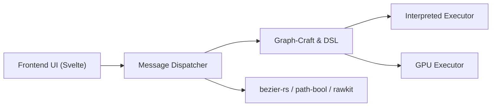

# GraphiteEditor/Graphite

> Alpha-stage vector and raster graphics editor built on a non-destructive node graph.

## The problem
Classic 2D creation tools are destructive and hard to parameterize; Graphite aims for a procedural workflow.

## What it actually does
A layer- and node-based editor, vector-first, evolving into a general-purpose tool (photo editing, painting, layout, VFX compositing, according to the roadmap). The interface is in Svelte, the core in Rust with a node graph engine (GPU and interpreted executors) and libraries (bezier-rs, rawkit, path-bool, math-parser).

## How it is wired

## Trying it
No documented command: the README points to the website.

## Cost and gotchas
Free. The README says it is in alpha; some announced features are "planned".

## What it is not
Not yet a full replacement for Photoshop or Illustrator. The `src-tauri` folder exists but Tauri is flagged as unused by the provided architecture.

## Alternatives
No alternative named in the README.

## For you
Ignore: alpha graphics editor, unrelated to data / AI pipelines.
