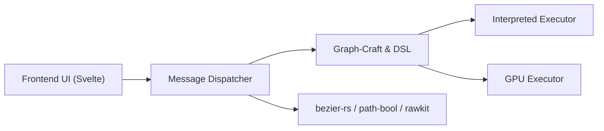

# GraphiteEditor/Graphite

> Éditeur graphique vectoriel et matriciel en alpha, fondé sur un graphe de nœuds non destructif.

## Le problème
Les outils de création 2D classiques sont destructifs et peu paramétrables ; Graphite vise un flux procédural.

## Ce que ça fait vraiment
Un éditeur à calques et à nœuds, d'abord vectoriel, qui évolue vers un outil généraliste (retouche photo, peinture, mise en page, composition VFX, selon la feuille de route). L'interface est en Svelte, le cœur en Rust avec un moteur de graphe de nœuds (exécuteurs GPU et interprété) et des bibliothèques (bezier-rs, rawkit, path-bool, math-parser).

## Comment c'est branché

## Essayer
Aucune commande documentée : le README renvoie au site web.

## Coût et pièges
Gratuit. Le README le dit en alpha ; les fonctions annoncées sont en partie « prévues ».

## Ce que ce n'est pas
Pas encore un remplaçant complet de Photoshop ou Illustrator. Le dossier `src-tauri` existe mais Tauri est signalé comme inutilisé par l'architecture fournie.

## Alternatives
Aucune alternative nommée dans le README.

## Pour toi
À ignorer : éditeur graphique en alpha, sans lien avec les pipelines data / IA.

