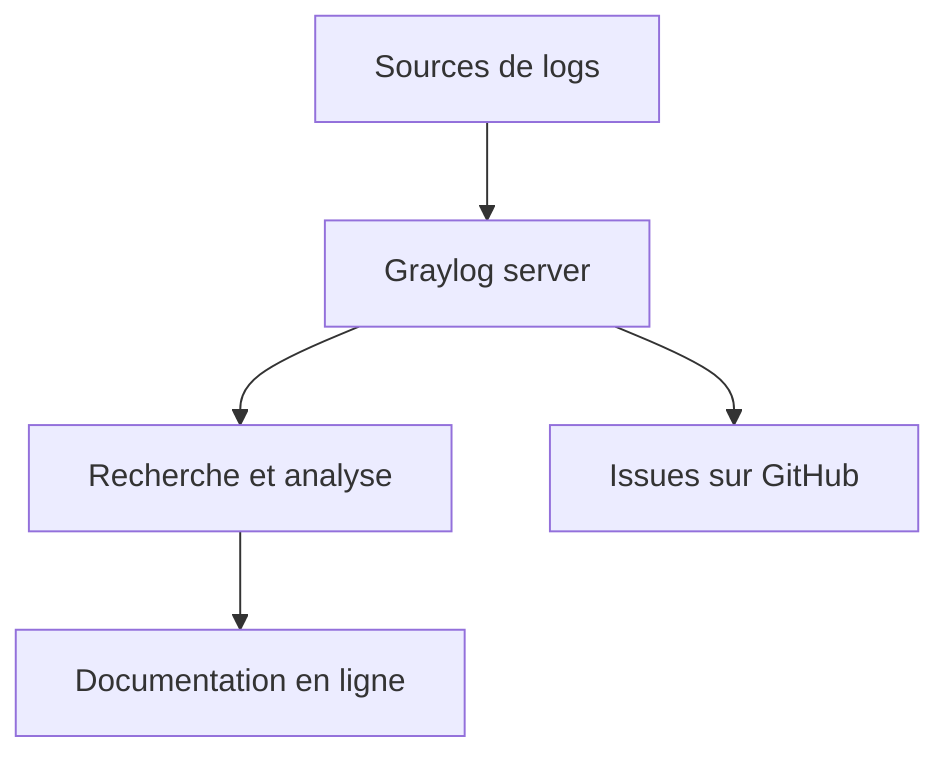

# Graylog2/graylog2-server

> Open log management platform, for centralizing and searching an infrastructure's logs.

## The problem
Logs scattered across many machines are hard to search and correlate.

## What it actually does
The README details nothing: it presents Graylog as a free log management platform and points to the website and the documentation. How it works, installation and prerequisites are not documented here.

## How it is wired
Simplified diagram based on the sheet, no diagram provided.

## Trying it
No command documented in the README; see the project's documentation.

## Cost and gotchas
Free according to the README. Prerequisites, storage and actual license are not documented here: to be checked (license not identified by GitHub). 2,116 open issues.

## What it is not
Not a tutorial or an installation sheet: the repository explains nothing. The real strengths are to be found on the website.

## Alternatives
No alternative named in the README.

## For you
Worth watching: a classic building block for MLOps platform logs, but the license must be checked before any enterprise use.
