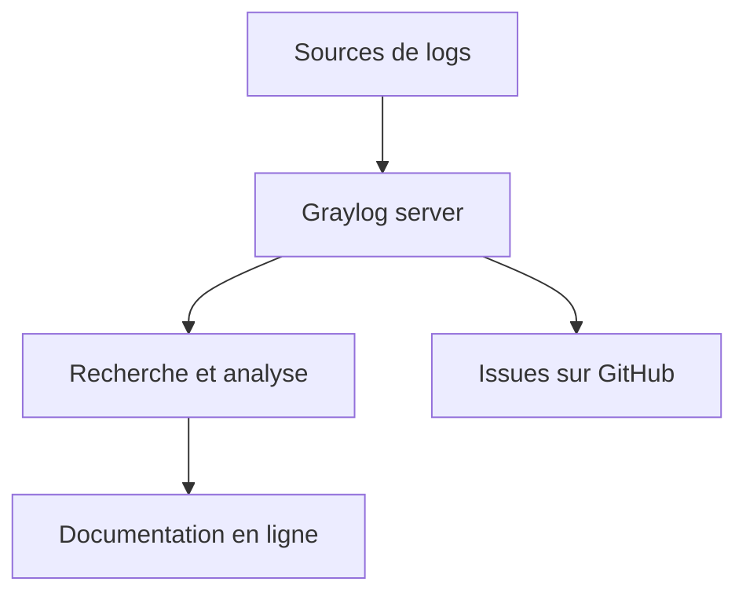

# Graylog2/graylog2-server

> Plateforme de gestion de logs ouverte, pour centraliser et chercher les journaux d'une infrastructure.

## Le problème
Les logs éparpillés sur de nombreuses machines sont difficiles à chercher et à corréler.

## Ce que ça fait vraiment
Le README ne détaille rien : il présente Graylog comme une plateforme libre de gestion de logs et renvoie au site et à la documentation. Le fonctionnement, l'installation et les prérequis sont non documentés ici.

## Comment c'est branché
Schéma simplifié d'après la fiche, sans diagramme fourni.

## Essayer
Aucune commande documentée dans le README ; voir la documentation du projet.

## Coût et pièges
Gratuit d'après le README. Prérequis, stockage et licence réelle non documentés ici : à vérifier (licence non identifiée par GitHub). 2 116 issues ouvertes.

## Ce que ce n'est pas
Pas un tutoriel ni une fiche d'installation : le dépôt n'explique rien. Les points forts réels sont à chercher sur le site.

## Alternatives
Aucune alternative nommée dans le README.

## Pour toi
À surveiller : brique classique pour les logs de plateformes MLOps, mais la licence est à vérifier avant tout usage en entreprise.

