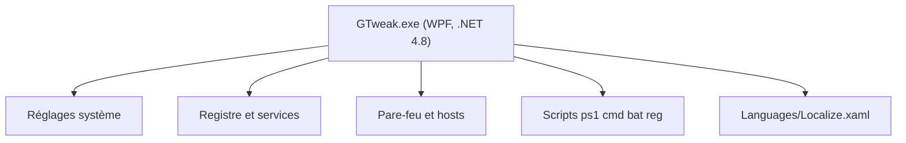

# Greedeks/GTweak

> Portable Windows utility to disable services, telemetry and preinstalled software, and to tweak the interface.

## The problem
A fresh Windows ships with telemetry, forced applications and useless services, which you disable by hand, one setting at a time.

## What it actually does
A WPF program (.NET Framework 4.8) run as administrator. It disables Defender, updates, telemetry, Cortana, Copilot and Recall, removes OneDrive, Edge and UWP applications, and adjusts themes, the taskbar and power settings. It also activates Windows via HWID or KMS and runs scripts with TrustedInstaller rights.

## How it is wired
Simplified diagram based on the sheet, no diagram provided.



## Trying it
```bash
# Aucune commande dans le README : exécuter l'application en administrateur,
# après l'avoir ajoutée aux exclusions de l'antivirus.
```

## Cost and gotchas
Free. It requires administrator rights and that the antivirus excludes it or is disabled. It turns off security protections.

## What it is not
It is not a safe tool for a professional workstation: it shuts down Defender, UAC and updates. It targets official Windows images, not stripped-down versions.

## Alternatives
No alternative named in the README.

## For you
Ignore: it has nothing to do with data or MLOps, and it weakens the security of a work machine.
