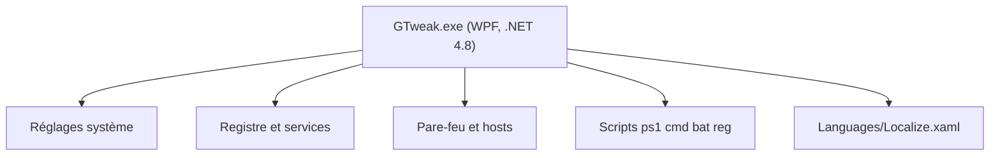

# Greedeks/GTweak

> Utilitaire Windows portable pour désactiver services, télémétrie et logiciels préinstallés, et régler l'interface.

## Le problème
Un Windows neuf embarque télémétrie, applications imposées et services inutiles, que l'on désactive à la main, réglage par réglage.

## Ce que ça fait vraiment
Un programme WPF (.NET Framework 4.8) lancé en administrateur. Il désactive Defender, mises à jour, télémétrie, Cortana, Copilot et Recall, retire OneDrive, Edge et les applications UWP, et ajuste thèmes, barre des tâches et alimentation. Il active aussi Windows par HWID ou KMS et exécute des scripts avec les droits TrustedInstaller.

## Comment c'est branché
Schéma simplifié d'après la fiche, sans diagramme fourni.



## Essayer
```bash
# Aucune commande dans le README : exécuter l'application en administrateur,
# après l'avoir ajoutée aux exclusions de l'antivirus.
```

## Coût et pièges
Gratuit. Il exige les droits administrateur et que l'antivirus l'exclue ou soit désactivé. Il désactive des protections de sécurité.

## Ce que ce n'est pas
Ce n'est pas un outil sûr pour un poste de travail professionnel : il coupe Defender, UAC et les mises à jour. Il vise des images Windows officielles, pas des versions allégées.

## Alternatives
Aucune alternative nommée dans le README.

## Pour toi
À ignorer : il n'a aucun rapport avec la data ou le MLOps, et il affaiblit la sécurité d'une machine de travail.

