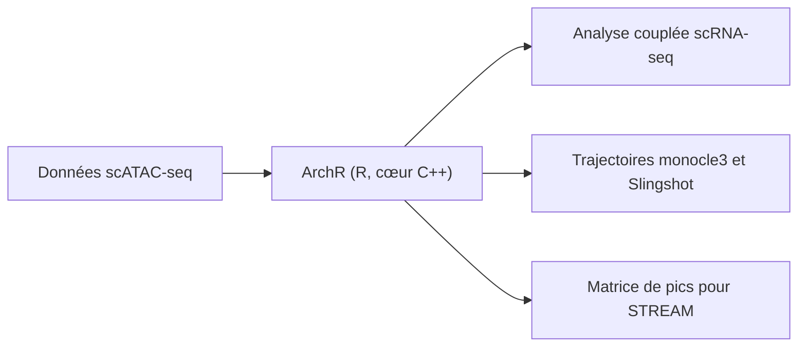

# GreenleafLab/ArchR

> R package for scATAC-seq (single-cell chromatin) data analysis.

## The problem
Analysing millions of ATAC-seq cells with limited resources.

## What it actually does
Full scATAC-seq processing and analysis, joint analysis with scRNA-seq, trajectories via monocle3 and Slingshot, export of a peak matrix for STREAM. The README claims 1 million cells in 8 hours on a laptop. `renv` environments (R 4.1 and 4.4) or Docker images with RStudio.

## How it is wired
Simplified diagram based on the sheet, no diagram provided.



## Trying it
```r
devtools::install_github("GreenleafLab/ArchR", ref="master", repos = BiocManager::repositories())
library(ArchR)
ArchR::installExtraPackages()
```
```bash
docker image pull greenleaflab/archr:latest
```

## Cost and gotchas
Free (MIT). Beta status; last push in February 2025; 183 open issues; many R dependencies.

## What it is not
Not a sequence alignment tool: it processes fragments that have already been produced.

## Alternatives
No alternative named in the README.

## For you
Watch: only useful in cellular genomics; maintenance has slowed since 2025.
