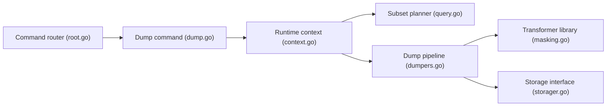

# GreenmaskIO/greenmask

> PostgreSQL logical dump utility with anonymization, subsets and synthetic data, for data and dev teams.

## The problem
Copying a production database to staging or dev exposes personal data and is too heavy.

## What it actually does
Acts as a proxy around the logical dump: selects objects, optionally extracts a consistent subset (including circular references), applies transformations during the dump (deterministic hash-based masking, dynamic parameters, conditions), stores the result (folder, S3, Azure, SFTP) and restores it. Dumps are `pg_restore`-compatible. MySQL is announced as "in progress".

## How it is wired


## Trying it
```bash
git clone git@github.com:GreenmaskIO/greenmask.git && cd greenmask
docker-compose run greenmask
```

## Cost and gotchas
Free, a single binary. The sandbox requires Docker. You have to write and validate the anonymization rules yourself.

## What it is not
Not a compliance guarantee: the quality of the anonymization depends on your transformations. MySQL is not finished.

## Alternatives
- pg_dump / pg_restore and mysqldump: standard tools that Greenmask replaces by adding transformations.

## For you
Adopt: it addresses a concrete need for anonymized test data that is compatible with existing PostgreSQL tools.
