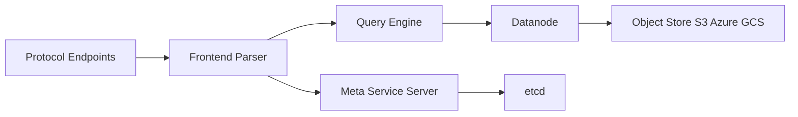

# GreptimeTeam/greptimedb

> Observability database that stores metrics, logs and traces in a single engine queryable with SQL.

## The problem
Stacking Prometheus, Loki and a trace store is costly to operate, and correlating the three signals forces you to jump from one tool to another.

## What it actually does
A columnar engine on object storage with a common table model (tags, timestamp, fields). Ingestion through OpenTelemetry, Prometheus Remote Write, Loki Push or Elasticsearch Bulk; queries in SQL and PromQL. Standalone mode (a single binary) or distributed: Frontend, Datanode, Metasrv and an optional Flownode for continuous computation.

## How it is wired


## Trying it
```bash
docker run -p 127.0.0.1:4000-4003:4000-4003 \
  -v "$(pwd)/greptimedb_data:/greptimedb_data" \
  --name greptime --rm greptime/greptimedb:latest standalone start \
  --http-addr 0.0.0.0:4000 --grpc-bind-addr 0.0.0.0:4001 \
  --mysql-addr 0.0.0.0:4002 --postgres-addr 0.0.0.0:4003
```
Dashboard at http://localhost:4000/dashboard.

## Cost and gotchas
The Apache-2.0 core is free, but read replicas, workload isolation and automatic repartitioning are reserved for the Enterprise edition. In distributed mode, repartitioning and region migration are manual.

## What it is not
Not a complete replacement: LogQL is not supported, and Elasticsearch's QueryDSL is only partial and reserved for Enterprise. Benchmark figures come from the vendor.

## Alternatives
- Prometheus, Loki, Tempo: the trio it aims to replace with a single backend.
- Thanos and Mimir: cited as a heavier operational surface.

## For you
Watch: relevant if you monitor ML pipelines or LLM agents and want to correlate metrics, logs and traces in SQL, to be validated on your volumes.
