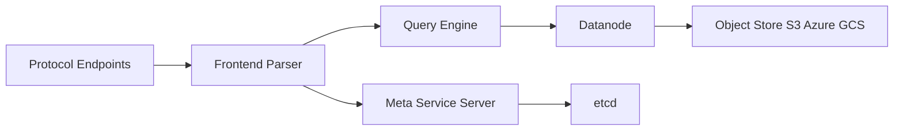

# GreptimeTeam/greptimedb

> Base de données d'observabilité qui stocke métriques, logs et traces dans un seul moteur interrogeable en SQL.

## Le problème
Superposer Prometheus, Loki et un stockage de traces coûte en exploitation, et corréler les trois signaux oblige à passer d'un outil à l'autre.

## Ce que ça fait vraiment
Un moteur colonnaire sur stockage objet avec un modèle de table commun (étiquettes, horodatage, champs). Ingestion par OpenTelemetry, Prometheus Remote Write, Loki Push ou Elasticsearch Bulk ; requêtes en SQL et PromQL. Mode autonome (un binaire) ou distribué : Frontend, Datanode, Metasrv et Flownode optionnel pour le calcul continu.

## Comment c'est branché


## Essayer
```bash
docker run -p 127.0.0.1:4000-4003:4000-4003 \
  -v "$(pwd)/greptimedb_data:/greptimedb_data" \
  --name greptime --rm greptime/greptimedb:latest standalone start \
  --http-addr 0.0.0.0:4000 --grpc-bind-addr 0.0.0.0:4001 \
  --mysql-addr 0.0.0.0:4002 --postgres-addr 0.0.0.0:4003
```
Tableau de bord sur http://localhost:4000/dashboard.

## Coût et pièges
Le cœur Apache-2.0 est gratuit, mais réplicas de lecture, isolation des charges et repartitionnement automatique sont réservés à l'édition Enterprise. En distribué, repartitionnement et migration de régions sont manuels.

## Ce que ce n'est pas
Pas un remplaçant complet : LogQL n'est pas géré, QueryDSL d'Elasticsearch n'est que partiel et réservé à l'Enterprise. Les chiffres de benchmark viennent de l'éditeur.

## Alternatives
- Prometheus, Loki, Tempo : le trio qu'il vise à remplacer par un seul backend.
- Thanos et Mimir : cités comme surface d'exploitation plus lourde.

## Pour toi
À surveiller : pertinent si tu surveilles des pipelines ML ou des agents LLM et veux corréler métriques, logs et traces en SQL, à valider sur tes volumes.

