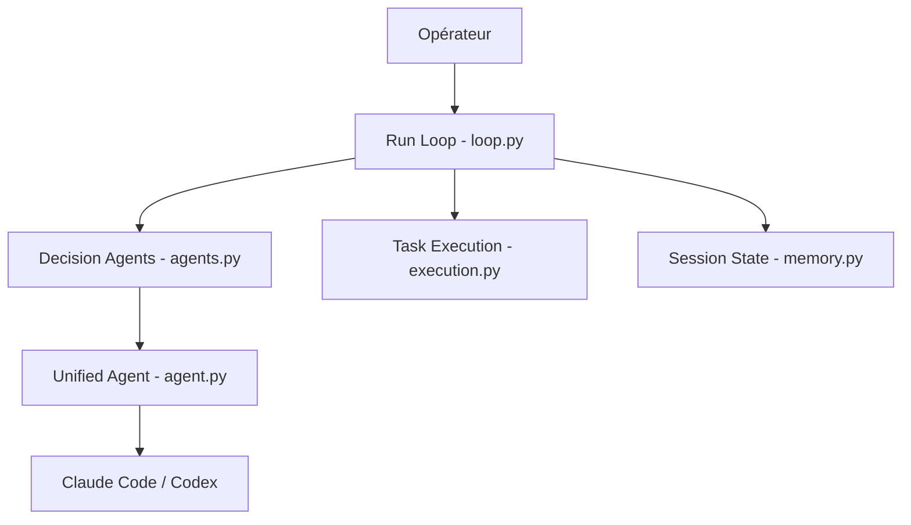

# GreyDGL/PentestGPT

> Command-line agent that drives Claude Code or Codex to run authorized penetration tests and CTFs.

## The problem
A penetration test or CTF chains reconnaissance, analysis and reporting, with many repetitive steps. Without tooling, everything rests on the operator.

## What it actually does
Two modes. An autonomous staged pipeline (CTF: recon → exploit → walkthrough; pentest: asset discovery → vulnerabilities → report) that delegates to Claude Code or Codex, with session saving and resuming. A legacy interactive mode, `pentestgpt-legacy`, with three LLM sessions (reasoning, generation, analysis) and a task tree; it accepts several providers, including Ollama locally.

## How it is wired


## Trying it
```bash
git clone https://github.com/GreyDGL/PentestGPT.git
cd PentestGPT
make install
pentestgpt --target 10.10.11.234
pentestgpt --list-sessions
make docker-build
make docker-login
```

## Cost and gotchas
Python 3.12+, uv, and the authenticated `claude` or `codex` CLI: tokens or subscription at your expense. Anonymous telemetry to Langfuse, which can be disabled (`--no-telemetry` or `LANGFUSE_ENABLED=false`).

## What it is not
Not a tool to run on a target without written authorization. The 86.5% on XBOW is a research result dated December 2025, not a guarantee about the current code.

## Alternatives
- aliasrobotics/cai: a competing framework, but archived.
- hexstrike-ai: an approach based on an MCP server and external tools.

## For you
Watch: interesting as a study of LLM agents with tools on a real use case (published at USENIX Security 2024), but dependent on paid third-party services, and to be reserved for authorized targets or labs.
