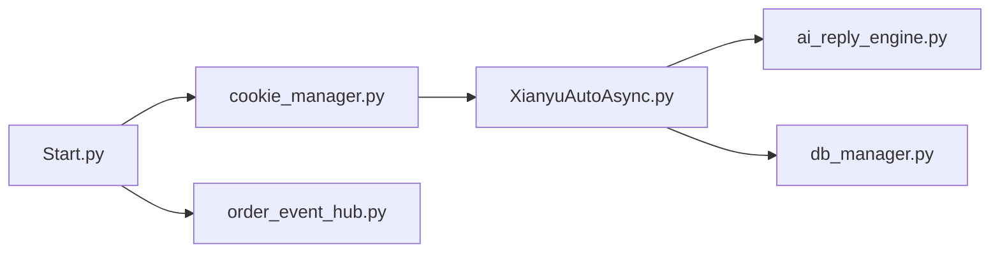

# GuDong2003/xianyu-auto-reply-fix

> Xianyu shop management platform: automatic replies, delivery, orders, multiple accounts.

## The problem
A seller on the Xianyu marketplace has to reply and deliver continuously, by hand.

## What it actually does
FastAPI + SQLite + Playwright application. Each seller account has an instance that follows messages over WebSocket; replies by keywords or by AI (OpenAI-compatible, Gemini, Anthropic, DashScope…), automatic delivery, product and order management, notifications, real-time logs. Multi-user web interface.

## How it is wired


## Trying it
```bash
git clone https://github.com/GuDong2003/xianyu-auto-reply-fix.git
cd xianyu-auto-reply-fix
docker compose up -d
```

## Cost and gotchas
Default admin password `admin123` and JWT key to be replaced; do not expose VNC (5900/6080); AI API key at your expense; account cookies are sensitive.

## What it is not
Not an official project: no link with Xianyu or Alibaba. Changes to the platform's interface can break the tool.

## Alternatives
XianyuAutoAgent and xianyu-auto-reply (sources of inspiration cited in the README).

## For you
Ignore: automation tool for one specific Chinese platform, with account risks and AGPL, unrelated to your profile.
