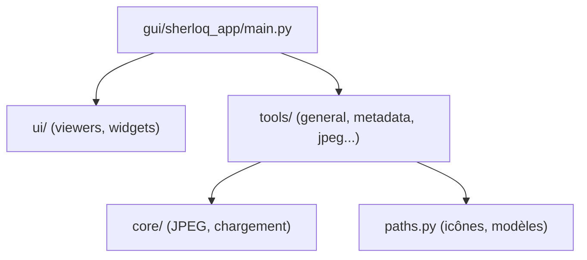

# GuidoBartoli/sherloq

> Graphical image forensics toolbox for experimenting with tampering-detection algorithms.

## The problem
Image forensics solutions are often proprietary, expensive and not very transparent.

## What it actually does
Python application (PySide, OpenCV, Matplotlib): EXIF metadata, histograms, ELA error levels, noise and PRNU, JPEG ghosts, copy-paste detection, resampling, illuminant. Some tools are not yet implemented; optional AI tools require extra packages.

## How it is wired
Simplified diagram based on the sheet, no diagram provided.


## Trying it
```bash
uv venv --python 3.11
uv pip install -r gui/requirements.txt
source .venv/bin/activate
python -m gui.sherloq_app
```

## Cost and gotchas
Free. Python 3.11; extra AI packages; on Linux, `libxcb-cursor-dev` may be missing. The author warns of bugs and missing features.

## What it is not
Not an automatic fake detector: it does not give a verdict. Not a finished product but an educational research tool.

## Alternatives
No alternative cited in the README.

## For you
Watch: useful to explore image tampering detection and methods such as PRNU or ELA, but still experimental.
