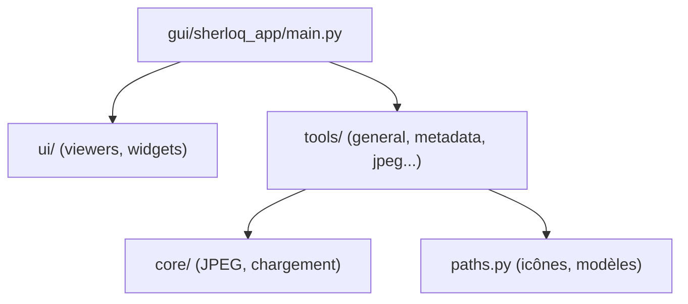

# GuidoBartoli/sherloq

> Boîte à outils graphique d'analyse forensique d'images, pour expérimenter des algorithmes de détection de falsification.

## Le problème
Les solutions forensiques d'image sont souvent propriétaires, chères et peu transparentes.

## Ce que ça fait vraiment
Application Python (PySide, OpenCV, Matplotlib) : métadonnées EXIF, histogrammes, niveaux d'erreur ELA, bruit et PRNU, fantômes JPEG, détection de copier-coller, rééchantillonnage, illuminant. Certains outils ne sont pas encore implémentés ; des outils IA optionnels exigent des paquets supplémentaires.

## Comment c'est branché
Schéma simplifié d'après la fiche, sans diagramme fourni.


## Essayer
```bash
uv venv --python 3.11
uv pip install -r gui/requirements.txt
source .venv/bin/activate
python -m gui.sherloq_app
```

## Coût et pièges
Gratuit. Python 3.11 ; paquets IA en plus ; sous Linux, `libxcb-cursor-dev` peut manquer. L'auteur prévient : bugs et fonctions manquantes.

## Ce que ce n'est pas
Pas un détecteur automatique de faux : il ne tranche pas. Pas un produit fini mais un outil éducatif de recherche.

## Alternatives
Aucune alternative citée dans le README.

## Pour toi
Surveiller : utile pour explorer la détection de falsification d'images et des méthodes comme PRNU ou ELA, mais en expérimentation.

