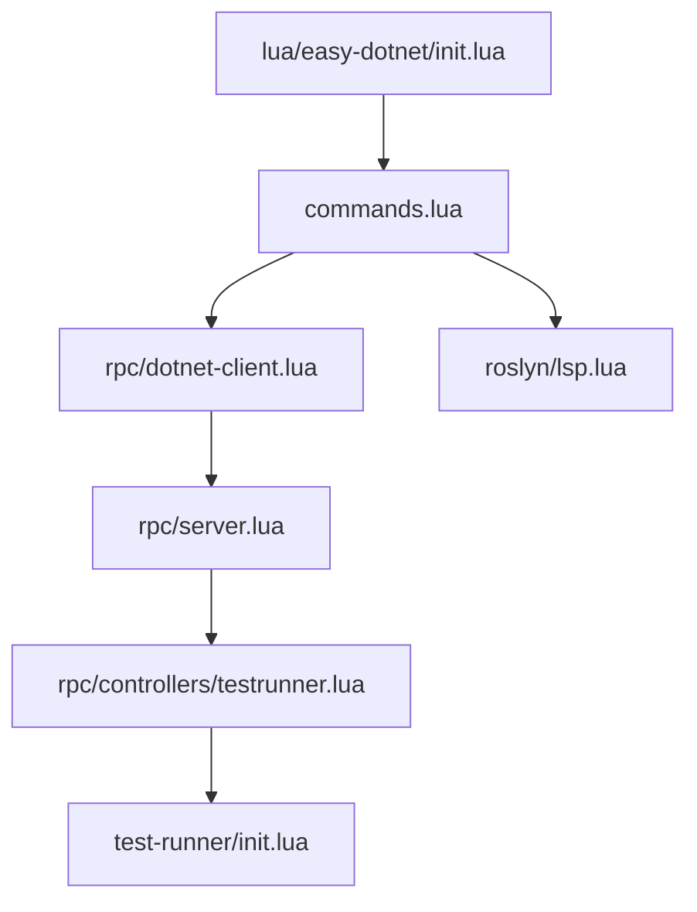

# GustavEikaas/easy-dotnet.nvim

> Neovim plugin that brings .NET IDE features: run, debug, test, NuGet packages.

## The problem
Moving from Rider to Neovim forces you to type long `dotnet` commands to run, test or manage secrets.

## What it actually does
Enables the Roslyn language server, a debugger (netcoredbg by default), a test runner, build, run, watch and Entity Framework commands, user-secrets management, package autocompletion in `.csproj` files and solution diagnostics. An EasyDotnet server talks to the plugin over RPC.

## How it is wired
Diagram based on the code diagram.


## Trying it
```bash
dotnet tool install -g EasyDotnet
# dans Neovim :
:Dotnet run
:Dotnet testrunner
:checkhealth easy-dotnet
```

## Cost and gotchas
Free. Requires Neovim 0.11 with LuaJIT, the .NET SDK and the EasyDotnet tool, which must be updated often. Razor uses an HTML server installed via npm.

## What it is not
Not a full IDE nor a Python tool. The provided README is truncated at the end.

## Alternatives
No alternative named in the README.

## For you
Ignore unless you develop in .NET under Neovim: nothing for a data / AI / MLOps profile.
