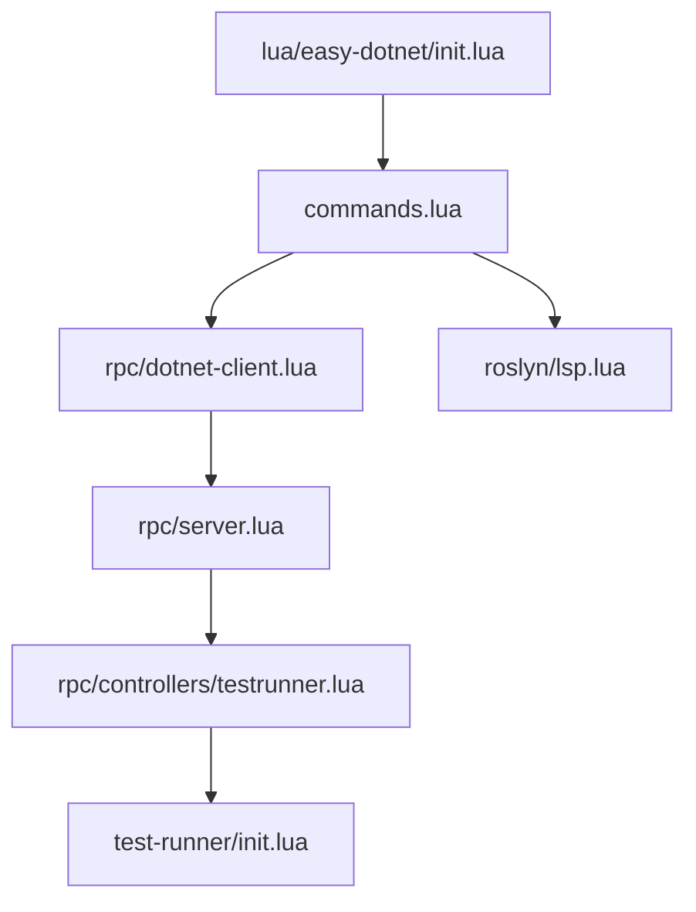

# GustavEikaas/easy-dotnet.nvim

> Plugin Neovim qui apporte les fonctions d'un IDE .NET : exécuter, déboguer, tester, paquets NuGet.

## Le problème
Passer de Rider à Neovim oblige à taper de longues commandes `dotnet` pour exécuter, tester ou gérer les secrets.

## Ce que ça fait vraiment
Active le serveur de langage Roslyn, un débogueur (netcoredbg par défaut), un lanceur de tests, des commandes build, run, watch et Entity Framework, la gestion des user-secrets, l'autocomplétion de paquets dans les `.csproj` et des diagnostics de solution. Un serveur EasyDotnet parle au plugin par RPC.

## Comment c'est branché
Schéma d'après le diagramme du code.


## Essayer
```bash
dotnet tool install -g EasyDotnet
# dans Neovim :
:Dotnet run
:Dotnet testrunner
:checkhealth easy-dotnet
```

## Coût et pièges
Gratuit. Demande Neovim 0.11 avec LuaJIT, le SDK .NET et l'outil EasyDotnet à mettre à jour souvent. Razor utilise un serveur HTML installé via npm.

## Ce que ce n'est pas
Pas un IDE complet ni un outil Python. Le README fourni est tronqué à la fin.

## Alternatives
Aucune alternative nommée dans le README.

## Pour toi
À ignorer sauf si tu développes en .NET sous Neovim : rien pour un profil data / IA / MLOps.

