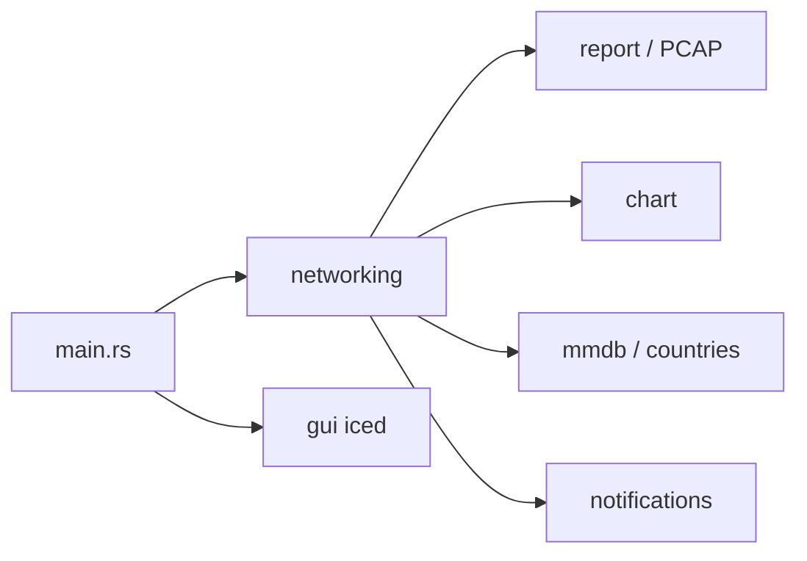

# GyulyVGC/sniffnet

> Rust desktop application for monitoring network traffic with statistics and maps.

## The problem
Seeing which connections and programs consume bandwidth requires command-line tools that are hard to read.

## What it actually does
Captures packets from a chosen network card, applies filters, displays real-time charts, geolocates remote hosts (MMDB databases), identifies 6,000+ services, exports and imports PCAP files, sends notifications on events, and compares against IP blacklists. Interface built with iced.

## How it is wired


## Trying it
The README offers DEB, RPM and AppImage packages to download. For faulty rendering:
```sh
ICED_BACKEND=tiny-skia
```

## Cost and gotchas
Free. System dependencies are required to analyze a network card. Older graphics drivers: switch to CPU rendering.

## What it is not
Not an IDS or a firewall: it observes and reports.

## Alternatives
No alternative named in the README.

## For you
Ignore: consumer network tool, unrelated to data/AI work.
