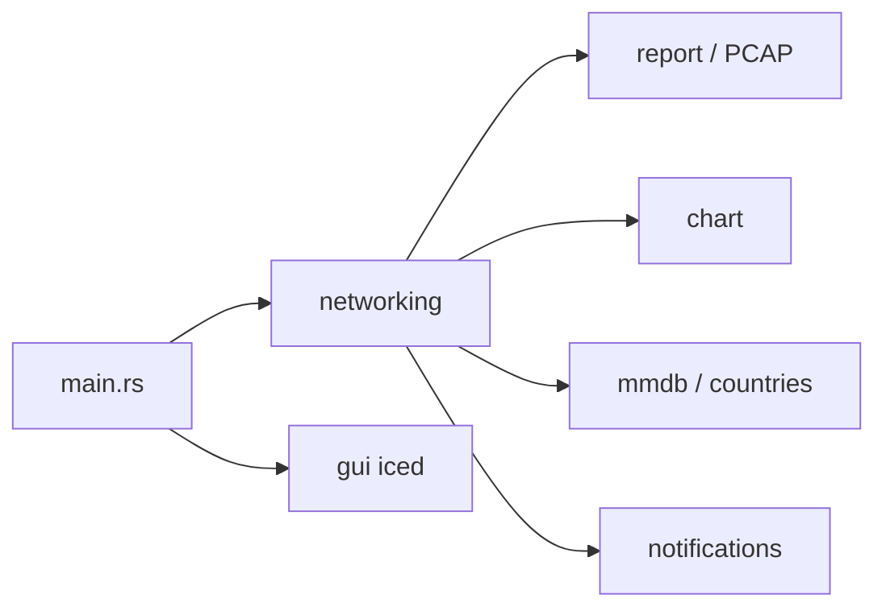

# GyulyVGC/sniffnet

> Application de bureau en Rust pour surveiller le trafic réseau avec statistiques et cartes.

## Le problème
Voir quelles connexions et quels programmes consomment la bande passante demande des outils en ligne de commande peu lisibles.

## Ce que ça fait vraiment
Capture les paquets d'une carte réseau choisie, applique des filtres, affiche des graphiques en temps réel, géolocalise les hôtes distants (bases MMDB), identifie 6 000+ services, exporte et importe des fichiers PCAP, notifie sur événements, compare à des listes noires d'IP. Interface construite avec iced.

## Comment c'est branché


## Essayer
Le README propose des paquets DEB, RPM et AppImage à télécharger. Pour un rendu défaillant :
```sh
ICED_BACKEND=tiny-skia
```

## Coût et pièges
Gratuit. Dépendances système nécessaires pour analyser une carte réseau. Pilotes graphiques anciens : bascule vers le rendu CPU.

## Ce que ce n'est pas
Pas un IDS ni un pare-feu : il observe et signale.

## Alternatives
Aucune alternative nommée dans le README.

## Pour toi
Ignorer : outil réseau grand public, sans lien avec le travail data/IA.

