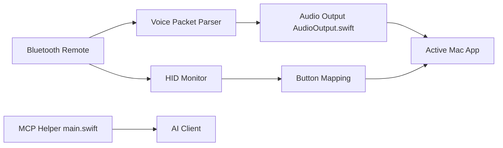

# HD838A/remote-mic-app

> macOS application that turns a Xiaomi Bluetooth remote into a wireless microphone and Mac controller.

## The problem
Dictating to or controlling a Mac from a Bluetooth remote requires a virtual microphone, shortcuts and permissions that have to be cobbled together.

## What it actually does
SwiftUI menu-bar app: receives the voice from the remote, routes it to a virtual audio device (`MiRemoteV 2ch`, derived from BlackHole) and sends key presses to the Mac. Button mapping, composite actions, per-application profiles and a local history of dictated texts, readable by AI clients through an MCP server over stdio. A Windows version is in preview.

## How it is wired


## Trying it
```bash
Aucune commande documentée.
```
The README goes through a PKG installer (`SayAll-VERSION-BUILD-AppleSilicon-install.pkg`) to download from the Releases.

## Cost and gotchas
Common phrases and Siri Remote support are reserved for members. You must grant Bluetooth, Input Monitoring and Accessibility. The README is in Chinese; the logo is a proprietary asset outside the GPL.

## What it is not
Not a transcription software: it routes the audio to the dictation tool of your choice. Several features (composite actions, profiles, history) are marked "validation in progress". Only the Xiaomi 2 and 2 Pro remotes are cited for voice.

## Alternatives
No alternative named in the README.

## For you
Ignore for a data/AI profile: a comfort gadget tied to specific hardware, in Chinese, unrelated to your work.
