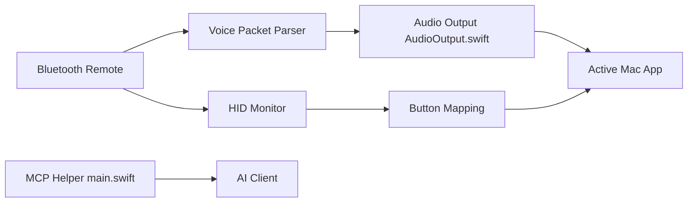

# HD838A/remote-mic-app

> Application macOS qui transforme une télécommande Bluetooth Xiaomi en micro sans fil et manette de Mac.

## Le problème
Dicter ou piloter un Mac depuis une télécommande Bluetooth exige un micro virtuel, des raccourcis et des permissions bricolés.

## Ce que ça fait vraiment
App SwiftUI de barre de menus : reçoit la voix de la télécommande, la route vers un périphérique audio virtuel (`MiRemoteV 2ch`, dérivé de BlackHole) et envoie les touches au Mac. Cartographie de boutons, actions composées, profils par application et historique local des textes dictés, lisible par des clients IA via un serveur MCP en stdio. Une version Windows est en préversion.

## Comment c'est branché


## Essayer
```bash
Aucune commande documentée.
```
Le README passe par un installeur PKG (`SayAll-VERSION-BUILD-AppleSilicon-install.pkg`) à télécharger depuis les Releases.

## Coût et pièges
Les phrases usuelles et la prise en charge de la Siri Remote sont réservées aux membres. Il faut accorder Bluetooth, Surveillance de l'entrée et Accessibilité. Le README est en chinois ; le logo est un actif propriétaire hors GPL.

## Ce que ce n'est pas
Pas un logiciel de transcription : il achemine l'audio vers l'outil de dictée de ton choix. Plusieurs fonctions (actions composées, profils, historique) sont marquées « validation en cours ». Seules les télécommandes Xiaomi 2 et 2 Pro sont citées pour la voix.

## Alternatives
Aucune alternative nommée dans le README.

## Pour toi
À ignorer pour un profil data/IA : gadget de confort lié à du matériel précis, en chinois, sans rapport avec ton travail.

