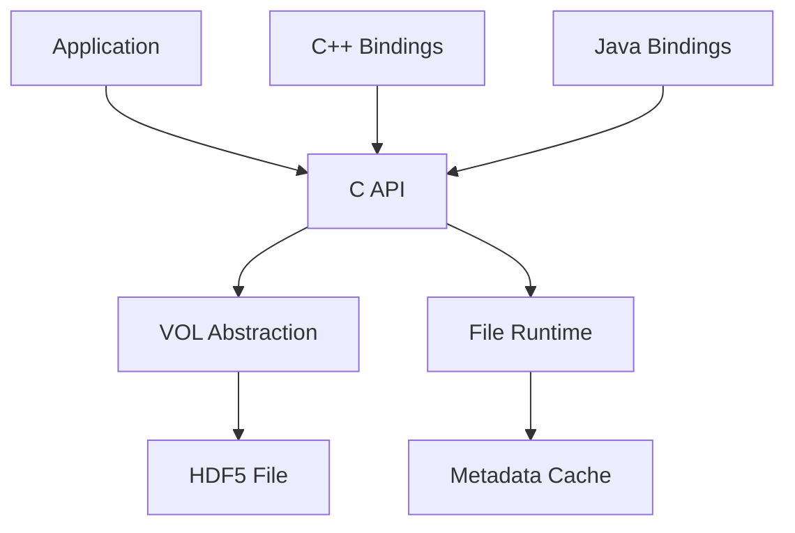

# HDFGroup/hdf5

> The reference library and file format for storing large volumes of hierarchical scientific data.

## The problem
Large scientific arrays need a portable, compressible, partially readable format, which a plain CSV cannot provide.

## What it actually does
A C API structures files, groups, datasets, types and selections. C++, Fortran and Java interfaces wrap it. The VOL layer routes storage access, with a metadata cache. Filters, chunking, virtual datasets and parallel MPI I/O are supported. Tools such as `h5diff` are provided.

## How it is wired

## Trying it
No command in the README: it points to INSTALL.md, INSTALL_CMake.md for CMake, and README_HPC.md for the parallel build.

## Cost and gotchas
You build it yourself, or use the release binaries. The license is present but not identified by GitHub: re-read it before any redistribution.

## What it is not
It is not a database or a dataframe format: it is a low-level container.

## Alternatives
No alternative named in the README.

## For you
Adopt: it is the building block under many data and model formats; above all, check the license text.
