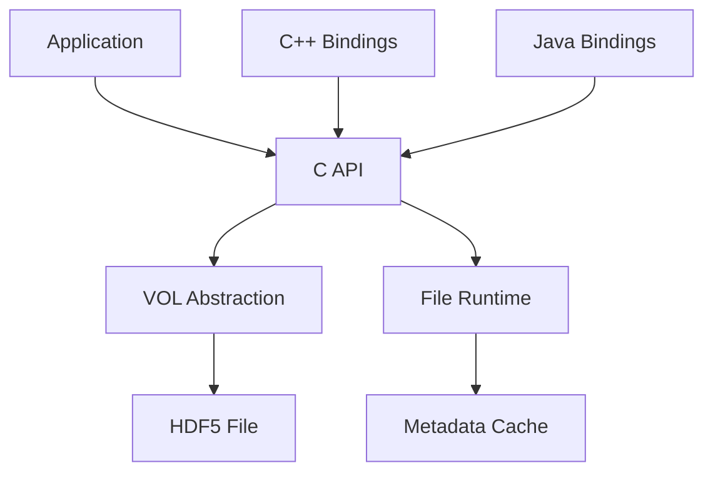

# HDFGroup/hdf5

> Bibliothèque et format de fichier de référence pour stocker de gros volumes de données scientifiques hiérarchiques.

## Le problème
Les gros tableaux de données scientifiques ont besoin d'un format portable, compressible et lisible partiellement, qu'un simple CSV ne permet pas.

## Ce que ça fait vraiment
Une API C structure fichiers, groupes, jeux de données, types et sélections. Des interfaces C++, Fortran et Java l'enveloppent. La couche VOL dirige l'accès au stockage, avec un cache de métadonnées. Filtres, fragmentation, jeux virtuels et E/S parallèle MPI sont prévus. Des outils comme `h5diff` sont fournis.

## Comment c'est branché

## Essayer
Aucune commande dans le README : il renvoie à INSTALL.md, INSTALL_CMake.md pour CMake et README_HPC.md pour le parallèle.

## Coût et pièges
Compilation à faire soi-même ou binaires des releases. La licence est présente mais non identifiée par GitHub : à relire avant toute redistribution.

## Ce que ce n'est pas
Ce n'est pas une base de données ni un format de dataframe : c'est un conteneur de bas niveau.

## Alternatives
Aucune alternative nommée dans le README.

## Pour toi
À adopter : c'est la brique sous de nombreux formats de données et de modèles ; vérifie surtout le texte de la licence.

