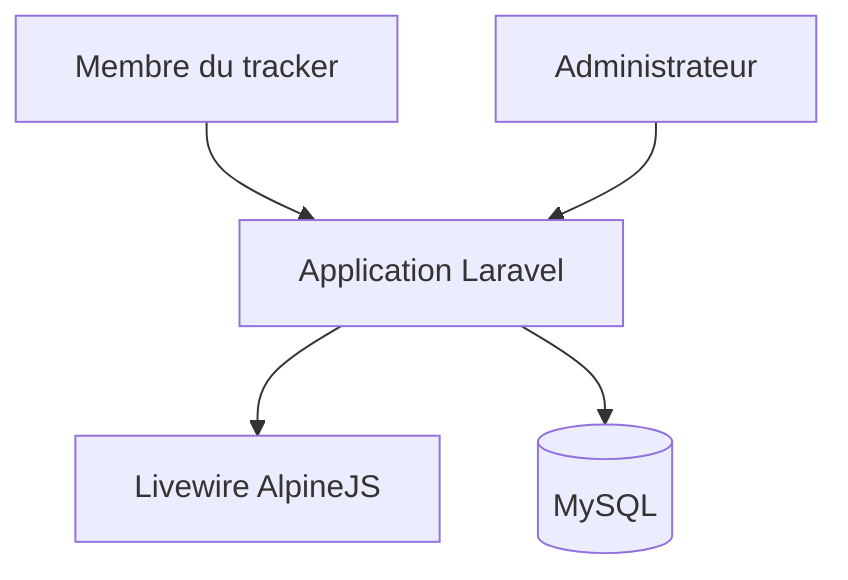

# HDInnovations/UNIT3D

> Private BitTorrent tracker software built with Laravel, Livewire and AlpineJS.

## The problem
Setting up and administering a private tracker requires a full platform: accounts, statistics, forum.

## What it actually does
Laravel web application in MVC architecture, compatible with strict MySQL and PHP 8.4. The README promises performance, security and scalability, without detailing the features. Translations go through Weblate. The official installation script is no longer available.

## How it is wired
Simplified diagram based on the sheet, no diagram provided.


## Trying it
```bash
sudo php artisan git:update
```
This command updates an existing installation; there is no longer an official installation procedure.

## Cost and gotchas
Free, but it requires PHP 8.4, MySQL and a web server; installation is not documented. AGPL-3.0: network copyleft. Running a tracker exposes you to copyright issues.

## What it is not
Not a torrent client nor a model-sharing tool: it is a tracker platform.

## Alternatives
No alternative named in the README.

## For you
Ignore: unrelated to your field, undocumented installation and potential legal issues.
