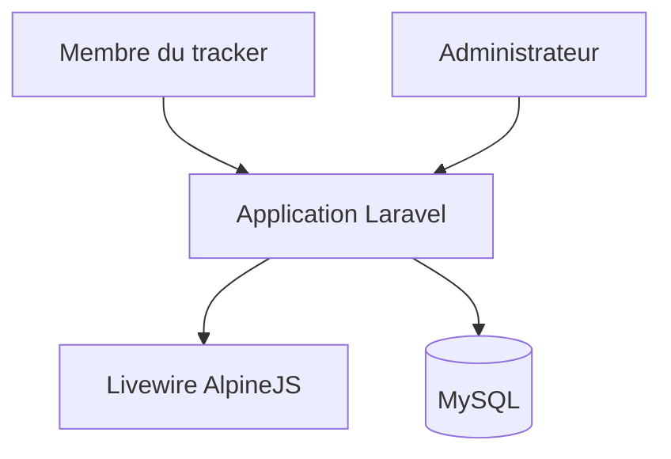

# HDInnovations/UNIT3D

> Logiciel de tracker BitTorrent privé construit avec Laravel, Livewire et AlpineJS.

## Le problème
Monter et administrer un tracker privé demande une plateforme complète : comptes, statistiques, forum.

## Ce que ça fait vraiment
Application web Laravel en architecture MVC, compatible MySQL strict et PHP 8.4. Le README promet performance, sécurité et évolutivité, sans détailler les fonctions. Les traductions passent par Weblate. Le script d'installation officiel n'est plus disponible.

## Comment c'est branché
Schéma simplifié d'après la fiche, sans diagramme fourni.


## Essayer
```bash
sudo php artisan git:update
```
Cette commande met à jour une installation existante ; il n'y a plus de procédure d'installation officielle.

## Coût et pièges
Gratuit, mais il faut PHP 8.4, MySQL et un serveur web ; l'installation n'est pas documentée. AGPL-3.0 : copyleft réseau. L'usage d'un tracker expose à des enjeux de droit d'auteur.

## Ce que ce n'est pas
Pas un client de torrent ni un outil de partage de modèles : c'est la plateforme d'un tracker.

## Alternatives
Aucune alternative nommée dans le README.

## Pour toi
À ignorer : sans rapport avec ton métier, installation non documentée et enjeux juridiques potentiels.

