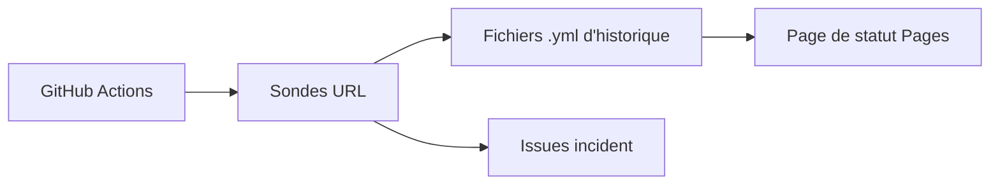

# HDVinnie/TrackerHub

> Uptime monitor and status page, via Upptime, for a list of private BitTorrent trackers.

## The problem
Knowing whether private sharing sites are online, without checking each one by hand.

## What it actually does
Upptime repository: GitHub Actions probes the URLs, issues serve as incident reports, GitHub Pages serves the status page. The README shows a table (Up/Down, response time, uptime) for about twenty trackers, its figures updated automatically.

## How it is wired

## Trying it
No command documented.

## Cost and gotchas
Free via GitHub. The monitored trackers are private torrent sites; the table data is that of the day.

## What it is not
Not a tool to reuse as is: it is an Upptime instance, not a product.

## Alternatives
Upptime (cited as the engine; provides "your own monitor").

## For you
Ignore: monitors torrent sites; if you want a status page, start from Upptime directly.
